# Native HSA physiological pockets

Atomic structures and geometric models of eleven physiological regions in
**native, 585-residue HSA**, sampled in three independent 1 µs simulations.
The collection includes a common HSA template, individual pocket templates,
and the original R1–R3 results.

## Choose a template

### Whole-protein representative

One observed frame is selected from the most populated group of overall HSA
conformations. **All eleven pockets are extracted from this same frame.**
Their relative positions, the shape of the protein and the surrounding residues
therefore belong to one coherent structure.

Use this model to study the intact protein, locate several binding regions at
once, or design a material around the complete HSA molecule.

### Pocket-shape representatives

Each pocket is considered separately. Frames containing space for the probe
are compared across the three simulations, and one observed frame is selected
to represent the most populated cavity-shape group. The selection reflects the **shape of that pocket**,
including where its internal space lies. It is not determined by volume alone.

Use these models to examine a particular cavity and its lining residues.
Different pockets can come from different frames. Each model includes its own
complete parent protein and geometric envelope. The selected structures are
observed conformations; the trajectory averages are reported separately below.

### Which should be used for MOF design?

**Start with the whole-protein model for intact-HSA templating or encapsulation.**
Use its atomic PDB to retain the exposed chemical groups, and its geometric
envelope to describe the overall size and shape. Protein-directed MOF
mineralization has been demonstrated experimentally, including with HSA
([Liang et al., 2015](https://pubmed.ncbi.nlm.nih.gov/26041070/)).

**Use the pocket-shape models as complementary local templates** when the design
concerns a specific cavity. They provide a cavity-focused choice of conformation
and its surrounding atoms. The two collections let the MOF group compare an
intact-protein design with a local-site design. Their suitability for a particular
MOF chemistry will require testing with that material's building blocks.

## The complete HSA template

<picture>
  <source media="(prefers-color-scheme: dark)" srcset="images/HSA_common_representative_dark.png">
  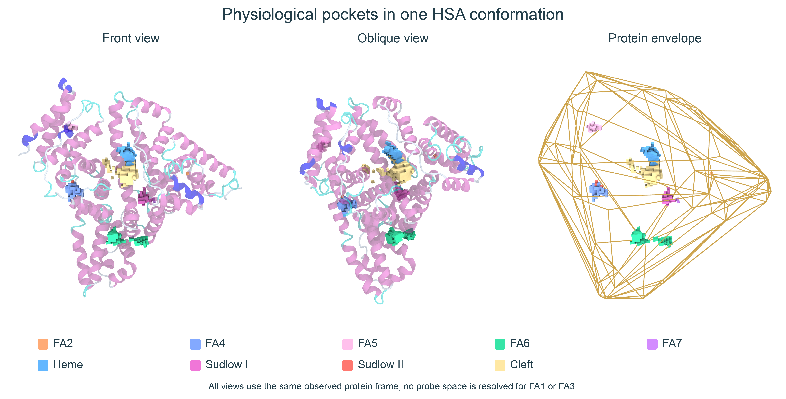
</picture>

The cartoon shows HSA secondary structure; colored regions show the available
probe-center space in its physiological pockets. The separate wireframe shows
the enclosing protein convex hull. A convex hull bridges surface indentations;
it is a coarse geometric envelope. The atomic PDB retains atomic detail and chemical identities.

[Protein PDB](structures/representative/whole_protein/protein.pdb) ·
[Protein with all probes, PDB](structures/representative/whole_protein/HSA_with_all_pockets.pdb) ·
[Protein hull with all probes, PDB](structures/representative/whole_protein/HSA_hull_with_all_pockets.pdb) ·
[OBJ](structures/representative/whole_protein/HSA_hull_with_all_pockets.obj) ·
[SDF](structures/representative/whole_protein/HSA_hull_with_all_pockets.sdf)

## Pocket volumes

The MD column is the mean ± SD of the three replica means. The other columns
give the probe-space volume in each selected structure; click a value to open
its model folder. All volumes are in ų.

| Pocket | MD mean ± SD | Whole protein | Pocket shape |
|---|---:|---:|---:|
| Cleft | 233.5 ± 103.8 | [250](structures/representative/whole_protein/Cleft) | [307](structures/representative/pocket_geometry/Cleft) |
| FA1 | 41.0 ± 13.1 | [0](structures/representative/whole_protein/FA1) | [129](structures/representative/pocket_geometry/FA1) |
| FA2 | 5.7 ± 4.6 | [1](structures/representative/whole_protein/FA2) | [11](structures/representative/pocket_geometry/FA2) |
| FA3 | 4.2 ± 4.4 | [0](structures/representative/whole_protein/FA3) | [3](structures/representative/pocket_geometry/FA3) |
| FA4 | 57.9 ± 33.2 | [53](structures/representative/whole_protein/FA4) | [120](structures/representative/pocket_geometry/FA4) |
| FA5 | 14.1 ± 15.0 | [26](structures/representative/whole_protein/FA5) | [38](structures/representative/pocket_geometry/FA5) |
| FA6 | 169.1 ± 24.5 | [168](structures/representative/whole_protein/FA6) | [199](structures/representative/pocket_geometry/FA6) |
| FA7 | 9.3 ± 5.5 | [2](structures/representative/whole_protein/FA7) | [25](structures/representative/pocket_geometry/FA7) |
| Heme | 173.5 ± 36.9 | [136](structures/representative/whole_protein/Heme) | [383](structures/representative/pocket_geometry/Heme) |
| Sudlow&nbsp;I | 65.9 ± 13.4 | [50](structures/representative/whole_protein/Sudlow_I) | [114](structures/representative/pocket_geometry/Sudlow_I) |
| Sudlow&nbsp;II | 16.4 ± 10.6 | [24](structures/representative/whole_protein/Sudlow_II) | [36](structures/representative/pocket_geometry/Sudlow_II) |

A zero means that the 1.4 Å probe has no accessible center positions within
the specified region in that frame. The physiological site is still defined by
its reference residues. These volumes describe the selected probe and region;
FA7 overlaps Sudlow I, and FA3/FA4 overlap Sudlow II.

[Full comparison table](tables/representative_comparison.csv) ·
[Source frames and lining residues](tables/representative_models.csv) ·
[Methods and table definitions](tables/README.md)

## See the different representations

Each gallery separates four views: **atomic pocket residues**, the **probe
surface**, **residues with the probe**, and the **residue convex hull** as a
wireframe. The probe surface is the mesh stored in OBJ/PLY. Its stepped boundary
retains the 1 Å calculation grid. The convex hull encloses lining atoms and has
a different shape from the cavity itself.

The upper row uses the whole-protein frame; the lower row uses the independently
selected pocket-shape frame. All eight panels for a given pocket share the same
scale and local alignment. The complete protein envelope is shown above and is
also included in the combined PDB files.

### Heme

<picture>
  <source media="(prefers-color-scheme: dark)" srcset="images/Heme_representatives_dark.png">
  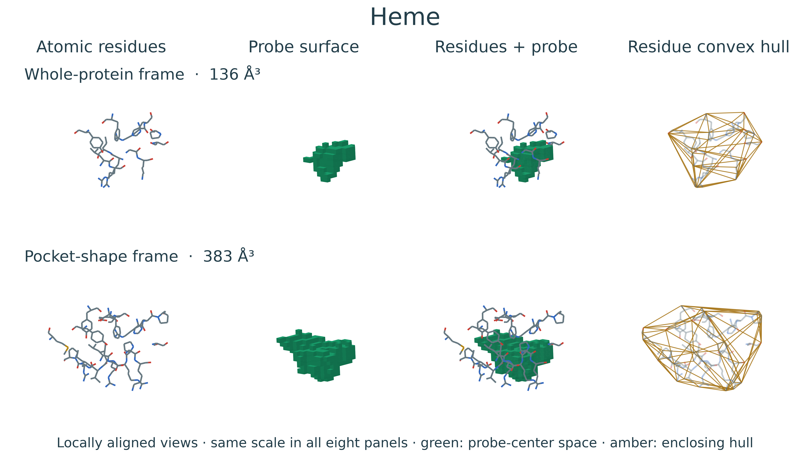
</picture>

[Whole-protein-frame files](structures/representative/whole_protein/Heme) ·
[Pocket-shape files](structures/representative/pocket_geometry/Heme)

### FA6

<picture>
  <source media="(prefers-color-scheme: dark)" srcset="images/FA6_representatives_dark.png">
  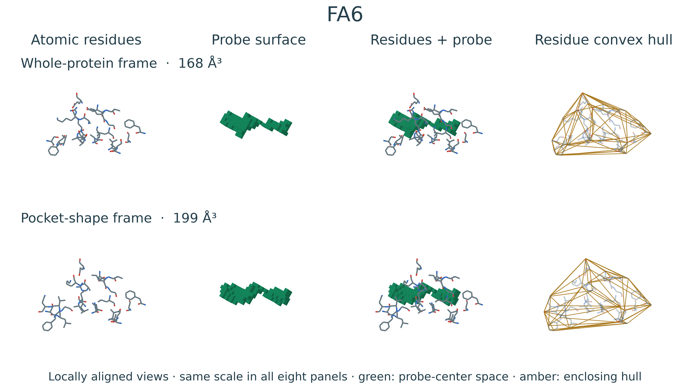
</picture>

[Whole-protein-frame files](structures/representative/whole_protein/FA6) ·
[Pocket-shape files](structures/representative/pocket_geometry/FA6)

### Sudlow I

<picture>
  <source media="(prefers-color-scheme: dark)" srcset="images/Sudlow_I_representatives_dark.png">
  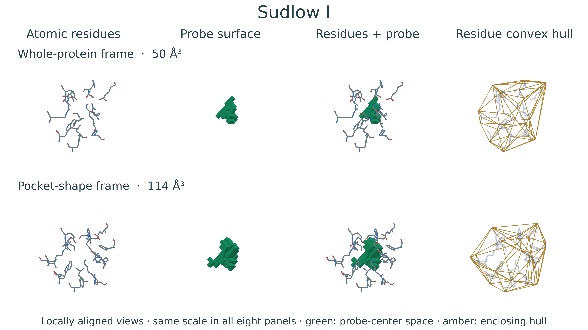
</picture>

[Whole-protein-frame files](structures/representative/whole_protein/Sudlow_I) ·
[Pocket-shape files](structures/representative/pocket_geometry/Sudlow_I)

<details>
<summary>Sudlow II — view all representations</summary>

### Sudlow II

<picture>
  <source media="(prefers-color-scheme: dark)" srcset="images/Sudlow_II_representatives_dark.png">
  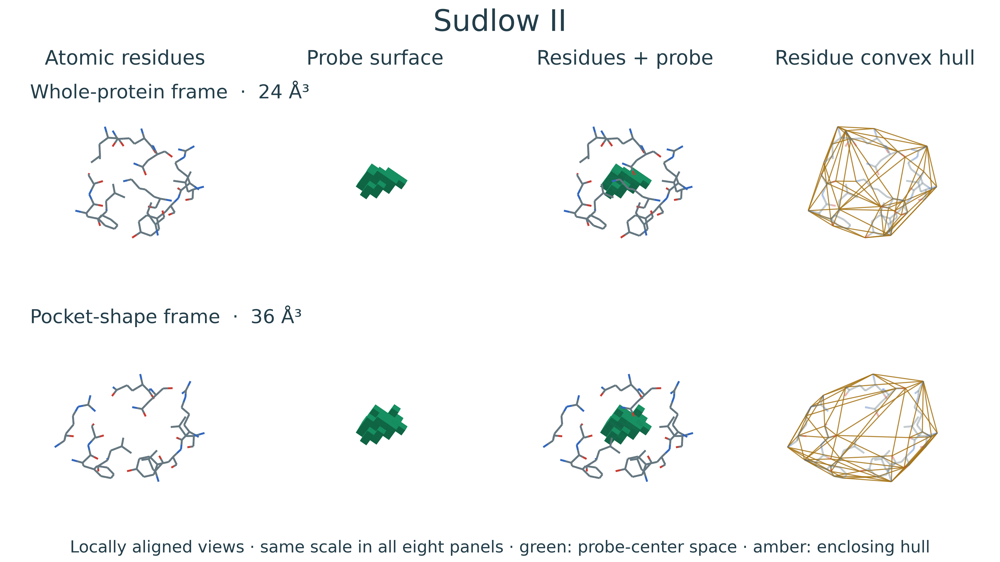
</picture>

[Whole-protein-frame files](structures/representative/whole_protein/Sudlow_II) ·
[Pocket-shape files](structures/representative/pocket_geometry/Sudlow_II)

</details>

<details>
<summary>FA1 — view all representations</summary>

### FA1

<picture>
  <source media="(prefers-color-scheme: dark)" srcset="images/FA1_representatives_dark.png">
  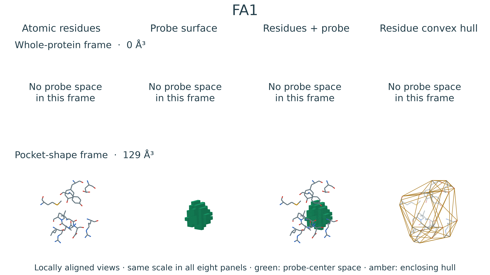
</picture>

[Whole-protein-frame files](structures/representative/whole_protein/FA1) ·
[Pocket-shape files](structures/representative/pocket_geometry/FA1)

</details>

<details>
<summary>FA2 — view all representations</summary>

### FA2

<picture>
  <source media="(prefers-color-scheme: dark)" srcset="images/FA2_representatives_dark.png">
  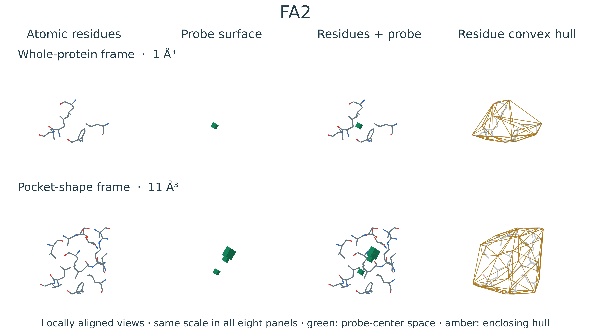
</picture>

[Whole-protein-frame files](structures/representative/whole_protein/FA2) ·
[Pocket-shape files](structures/representative/pocket_geometry/FA2)

</details>

<details>
<summary>FA3 — view all representations</summary>

### FA3

<picture>
  <source media="(prefers-color-scheme: dark)" srcset="images/FA3_representatives_dark.png">
  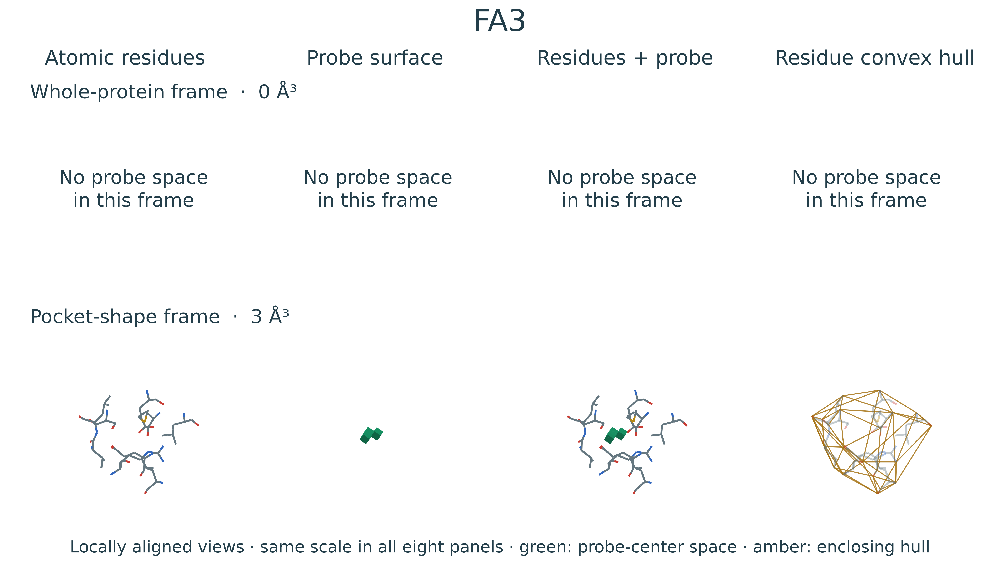
</picture>

[Whole-protein-frame files](structures/representative/whole_protein/FA3) ·
[Pocket-shape files](structures/representative/pocket_geometry/FA3)

</details>

<details>
<summary>FA4 — view all representations</summary>

### FA4

<picture>
  <source media="(prefers-color-scheme: dark)" srcset="images/FA4_representatives_dark.png">
  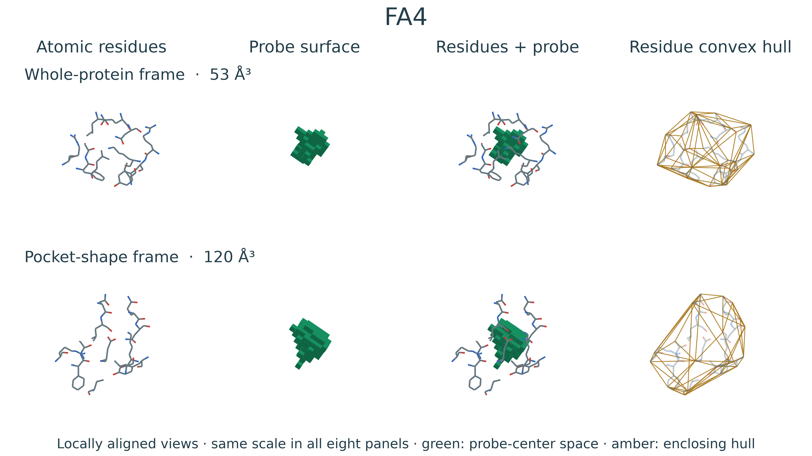
</picture>

[Whole-protein-frame files](structures/representative/whole_protein/FA4) ·
[Pocket-shape files](structures/representative/pocket_geometry/FA4)

</details>

<details>
<summary>FA5 — view all representations</summary>

### FA5

<picture>
  <source media="(prefers-color-scheme: dark)" srcset="images/FA5_representatives_dark.png">
  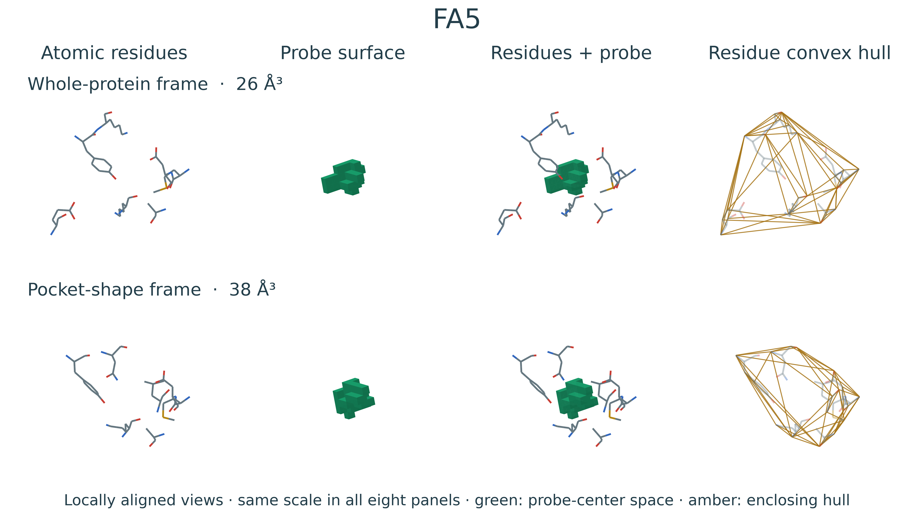
</picture>

[Whole-protein-frame files](structures/representative/whole_protein/FA5) ·
[Pocket-shape files](structures/representative/pocket_geometry/FA5)

</details>

<details>
<summary>FA7 — view all representations</summary>

### FA7

<picture>
  <source media="(prefers-color-scheme: dark)" srcset="images/FA7_representatives_dark.png">
  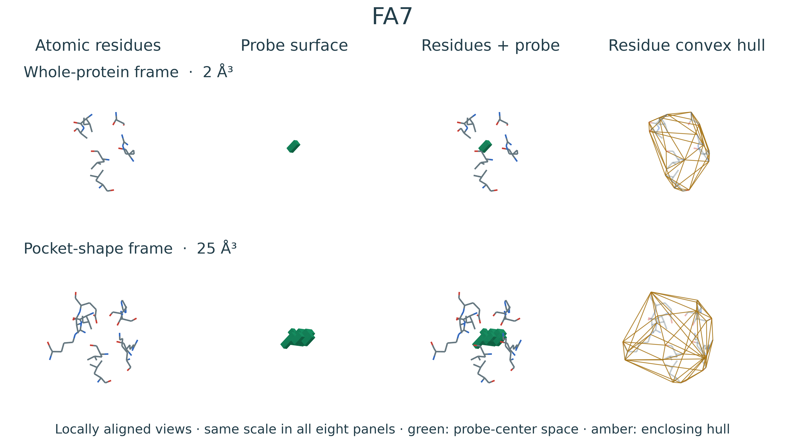
</picture>

[Whole-protein-frame files](structures/representative/whole_protein/FA7) ·
[Pocket-shape files](structures/representative/pocket_geometry/FA7)

</details>

<details>
<summary>Cleft — view all representations</summary>

### Cleft

<picture>
  <source media="(prefers-color-scheme: dark)" srcset="images/Cleft_representatives_dark.png">
  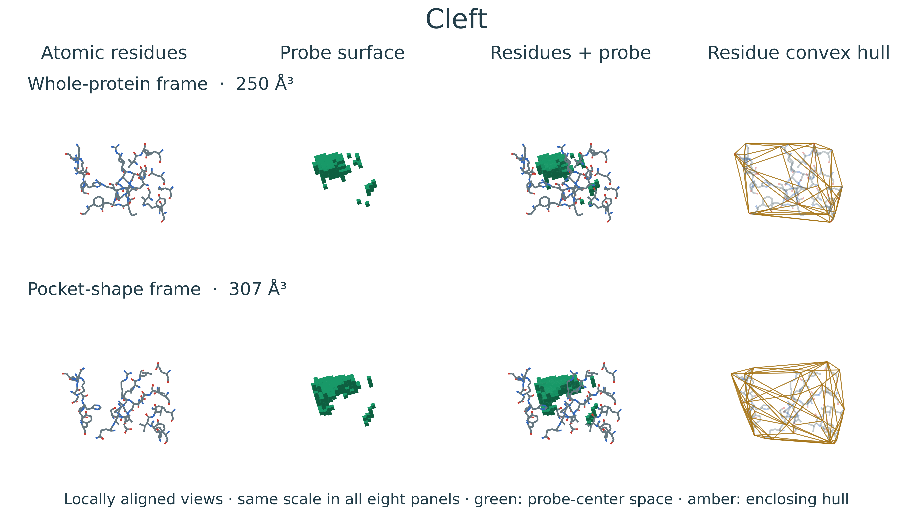
</picture>

[Whole-protein-frame files](structures/representative/whole_protein/Cleft) ·
[Pocket-shape files](structures/representative/pocket_geometry/Cleft)

</details>

## Find the files

```text
structures/
├── representative/
│   ├── whole_protein/       One HSA frame with all eleven pockets
│   └── pocket_geometry/     One frame selected for each pocket
├── R1/                     Original per-replica models
├── R2/
└── R3/
tables/                     Volumes, source frames and methods
images/                     Transparent previews
```

Every pocket folder contains the following models. Coordinates are in Å.

| File | Contents |
|---|---|
| `pocket_atoms.pdb` | Actual pocket-lining residues |
| `region_atoms.pdb` | Residues defining the physiological reference region |
| `probe.pdb`, `.obj`, `.ply` | Accessible probe-center space |
| `lining_hull.pdb`, `.obj`, `.ply` | Convex envelope of the lining-residue heavy atoms |
| `pocket_with_geometry.pdb` | Pocket atoms, probe model and complete protein hull |
| `protein_with_pocket.pdb` | Complete protein, that pocket's probe and protein hull |
| `protein.pdb`, `protein_hull.*` | Complete parent protein and its enclosing hull; in the parent directory for the whole-protein collection |

Every OBJ also has **SDF, MOL and MOL2** exports. Their vertices and edges describe
geometry. They use virtual atoms (`*` or `Du`); chemical atoms remain in the atomic
PDB files. OBJ/PLY retain the triangular surface faces.

The original R1, R2 and R3 models and numerical results are retained. Each replica
has two whole-protein cluster representatives, with all eleven regions extracted
from each frame. Frame identities, clustering details and the definitions of all
tables are in [Methods and numerical results](tables/README.md).
