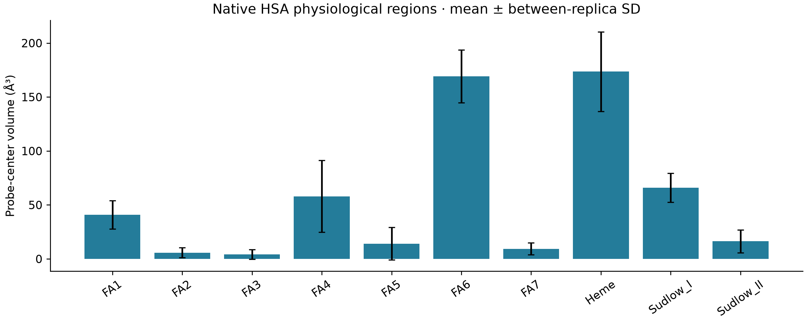
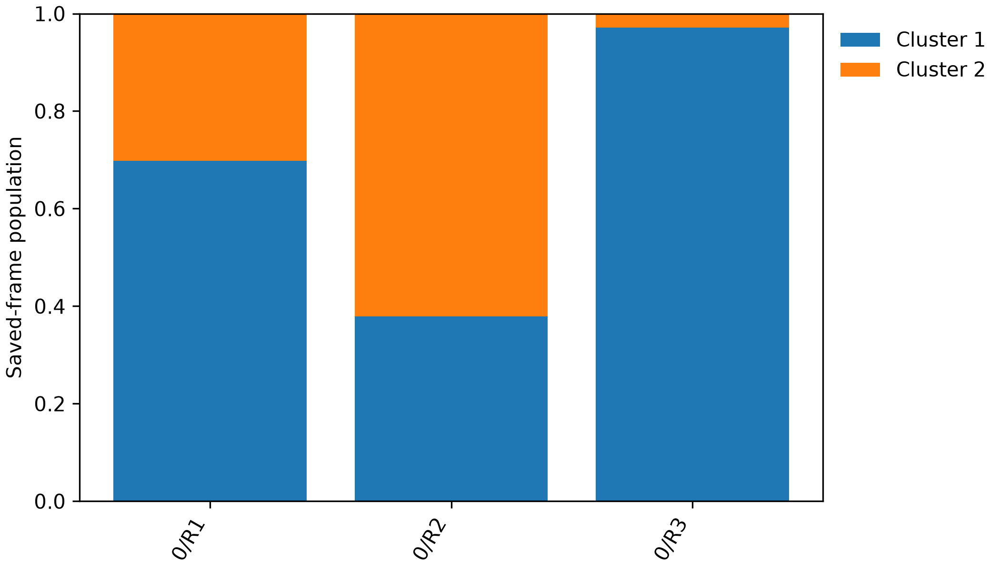
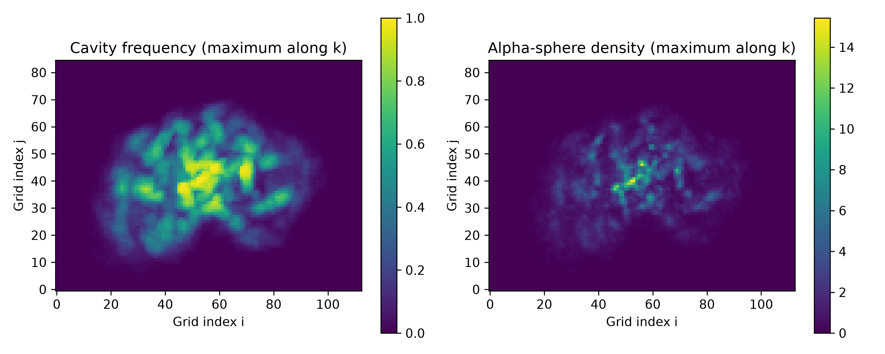

# Native HSA pocket results

Pocket geometry and detection results for the **new full-length, 585-residue native HSA** campaign: three independent 1 µs production trajectories (R1–R3; 3 µs total). Each replica contains 10,000 saved frames at 0.1 ns intervals. This repository contains the native results, representative structures, figures, tables and supporting provenance.

## Read or download

- Read the numerical summary below and browse the [tables](tables), [physiological structures](physiological), [MDpocket results](detected) and [figures](figures).
- For the illustrated report, use **Code → Download ZIP**, extract the entire archive, then open [report/index.html](report/index.html) in a browser. It works offline; keep the extracted folders together. GitHub shows HTML source when viewing the file directly.
- For a protein with every physiological region in context, open `physiological/R#/cluster_#/HSA_with_all_pockets.pdb` in a molecular viewer. Protein-only and individual pocket PDBs, OBJ/PLY meshes and matching Amber topologies are adjacent.

## Main results

The ligand-informed heme region and FA6 have mean probe-center free volumes of **173.5 ± 36.9 ų** and **169.1 ± 24.5 ų**. The landmark-bounded cleft averages **233.5 ± 103.8 ų**. Sudlow I and II average **65.9 ± 13.4 ų** and **16.4 ± 10.6 ų**. These are the mean and sample SD of three equally weighted replica means, calculated from 102 sampled frames per replica. SD describes differences between replica means.

| Region | Mean volume (ų) | Between-replica SD (ų) |
|---|---:|---:|
| Cleft | 233.5 | 103.8 |
| FA1 | 41.0 | 13.1 |
| FA2 | 5.7 | 4.6 |
| FA3 | 4.2 | 4.4 |
| FA4 | 57.9 | 33.2 |
| FA5 | 14.1 | 15.0 |
| FA6 | 169.1 | 24.5 |
| FA7 | 9.3 | 5.5 |
| Heme | 173.5 | 36.9 |
| Sudlow I | 65.9 | 13.4 |
| Sudlow II | 16.4 | 10.6 |

Source: [pocket_volume_summary.csv](tables/pocket_volume_summary.csv); [per-frame values](tables/sampled_pocket_volumes.csv) and [replica summaries](tables/per_replica_pocket_volumes.csv).

## Observed representative structures

Two neutral cluster IDs describe protein conformational groups in the saved trajectories. The protein and all eleven regions within each folder come from the **same actual MD frame**. The six structures below support 66 region models. Cluster assignments are descriptive and depend on the selected feature model.

| Replica | Cluster | Saved-frame population | Frame | Production (%) | Structure |
|---|---:|---:|---:|---:|---|
| R1 | 1 | 69.77% | 4532 | 45.32 | [PDB](physiological/R1/cluster_1/protein.pdb) |
| R2 | 1 | 37.92% | 4648 | 46.48 | [PDB](physiological/R2/cluster_1/protein.pdb) |
| R3 | 1 | 97.17% | 7499 | 74.99 | [PDB](physiological/R3/cluster_1/protein.pdb) |
| R1 | 2 | 30.23% | 7432 | 74.32 | [PDB](physiological/R1/cluster_2/protein.pdb) |
| R2 | 2 | 62.08% | 9134 | 91.34 | [PDB](physiological/R2/cluster_2/protein.pdb) |
| R3 | 2 | 2.83% | 857 | 8.57 | [PDB](physiological/R3/cluster_2/protein.pdb) |

The frame index starts at 1, corresponding to 0.1 ns of production. Production time is frame × 0.1 ns; Amber absolute simulation time also includes a 2.2 ns preproduction interval. A `production_percent` of 45.32 therefore means 453.2 ns in the 1000 ns production interval. [All assignments and cluster selection data](tables/clustering) retain the original metadata, including two additional common representatives in [structures/clustering](structures/clustering).

## How the regions were measured

Physiological ligand regions were transferred to the new native reference using local canonical Cα anchors, then fitted locally on each observed frame. The transfer preserves the original experimental ligand sphere definitions. Heme uses the preserved 1O9X hemin definition. The [native context record](provenance/native_context_prepared.json), [transferred region definitions](provenance/region_definitions) and [residue map](provenance/residue_mapping.csv) document this ancestry and the current 585-residue mapping. Historical source paths in provenance refer to definition ancestry; the trajectories and structures collected here belong to `series_585_apbs`.

Protein atoms exclude space using the analysis element radii. A spherical probe of radius 1.4 Å is evaluated on a 1 Å grid; seed-connected accessible voxels inside the defined region determine the reported probe-center volume. The cleft uses free space inside a moving convex hull of its residue landmarks. The reported volume is restricted to the defined ligand region. A zero value means no selected probe-center voxels for that region and frame under these definitions; it does not establish that the physiological pocket is absent. Empty geometry exports are retained for those zero-volume cases.

FA7 overlaps Sudlow I, and FA3/FA4 overlap Sudlow II; overlapping regions must not be summed as independent capacities. Grid-boundary contact can indicate truncation. Protein and lining hulls describe atomic envelopes and are distinct from probe-center free space. The cleft is not separately identified as FA8 and FA9.

Clustering uses standardized domain I–III distance, domain I–II–III angle and native-contact fraction. K-means, Ward and DBSCAN candidates were compared on 200 uniformly sampled frames per replica. The selected Ward-centroid model has two clusters; all saved frames were assigned by nearest centroid. Representatives are observed cluster members closest to the cluster feature mean. See [clustering_metadata.json](tables/clustering/clustering_metadata.json) for selection details and limitations.

## MDpocket detection and sampled persistence

[detected/R1](detected/R1), [R2](detected/R2) and [R3](detected/R3) retain per-frame fpocket cavities, provisional lining-residue tracks, sampled-frame persistence summaries, MDpocket frequency/density grids and detection-region meshes at frequency cutoffs 0.2, 0.5 and 0.8. The original OpenDX grids are losslessly compressed as `.dx.gz`; decompress them before opening in a viewer that requires plain `.dx`. Numerical frequency/density arrays are also in `pocket_grids.npz`.

These 102 sampled frames span 0.1–1000 ns at approximately 9.9 ns intervals, with the final endpoint included. Cavity alignment uses the fixed domain II core, canonical residues 207–236. Frequency regions report where cavity detections recur; their mesh volumes are **detection-region volumes**, distinct from physiological probe-center free volumes. Density reports alpha-sphere density. Tracks use exact lining sets followed by an adjacent-frame Jaccard graph (cutoff 0.3; at least three shared residues). Split/merge edges are retained; gaps terminate tracks. Track spans are sampled observations, not physical lifetimes. Site assignments from residue overlap remain candidate annotations requiring spatial review. These outputs do not establish binding affinity or druggability.

## Provenance and validation

The source is `CATIONIZED_HSA/series_585_apbs` on ciamician, collected on 2026-10-21. The original completed pocket archive has SHA256 `98d7baf81275119e5446e3bbb70e10a8d68e393cb05a11f75fdccfb3c48e19f2`; all 1,662 files in its completion manifest were checked against their recorded hashes before curation. The original archive remains preserved outside this repository.

[production_artifact_audit.json](provenance/production_artifact_audit.json) records independent checks of all twelve production segments: restart hashes and ancestry, finite coordinates/velocities/box, trajectory presence, terminal step/time/temperature, completion wall time and fatal-pattern scans. Every replica reaches 1000 ns production with 10,000 frames. [Per-replica validation](provenance/replicas) confirms 585 protein residues and 9,228 protein atoms after water/ion removal. [collection_mapping.json](provenance/collection_mapping.json) maps copied artifacts to their sources and documents path adjustments; [inventory.csv](provenance/inventory.csv) and [SHA256SUMS](SHA256SUMS) cover the curated files.

This is a data-only sharing repository. Raw trajectories, analysis programs, submission scripts and viewer scripts are omitted. Molecular coordinates and mesh dimensions are in Å.
