<h1 align="center">Native HSA physiological pockets</h1>

<picture>
  <source media="(prefers-color-scheme: dark)" srcset="images/banner_dark.svg">
  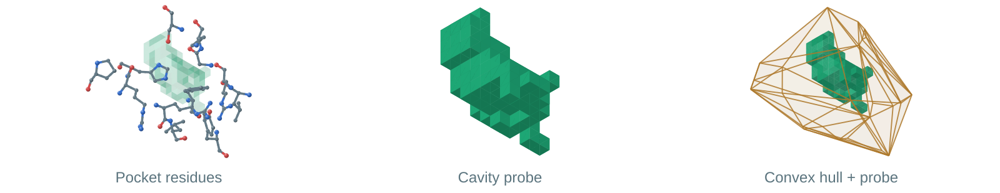
</picture>

Atomic structures and geometric models of eleven physiological regions in
**native, 585-residue HSA**, sampled in three independent 1 µs simulations.
The collection includes a common HSA template, individual pocket templates,
and the original R1-R3 results.

## Choose a template

The **whole-protein representatives** were selected by clustering the three
HSA trajectories using standardized Domain I-III distance, the I-II-III
opening angle and the fraction of native I-III contacts. Ward, k-means and
DBSCAN were compared on 600 uniformly sampled frames, 200 per replica.
Candidates were ranked by the fraction of assigned frames multiplied by
the silhouette score.

| Method | Groups | Assigned training frames | Silhouette | Coverage × silhouette |
|---|---:|---:|---:|---:|
| Ward | 2 | 100.0% | 0.382 | 0.382 |
| K-means | 2 | 100.0% | 0.366 | 0.366 |
| DBSCAN | 3 | 68.2% | 0.293 | 0.200 |

Ward gave the highest score and identified two groups. All 30,000 saved frames
were assigned to their nearest group center. The observed frame closest to
each center was retained, and all eleven pocket geometries were calculated
on that frame. DBSCAN left 31.8% of the training frames and 33.0% of the full
dataset unassigned.

The **pocket-shape representatives** were selected separately for each pocket
from 306 frames, sampled equally across the three simulations. Locally aligned
cavity shapes were grouped by spatial overlap. DBSCAN identified two nonempty
groups for FA5; the other pockets were each represented by one nonempty group.
Within the largest group, the frame with the smallest average shape difference
from the other members was retained.

The **mean-volume representatives** were selected separately for each pocket
as the observed frame whose cavity volume was closest to the mean over the
same 306 sampled frames.

[Detailed methods and clustering comparisons](tables/README.md).

### Whole-protein representative

The dominant conformation represents the largest protein cluster, containing
68.3% of the frames. The alternative represents the second cluster, containing
31.7%. All eleven pockets in each collection were calculated on its selected
protein frame.

The dominant model is in
[`whole_protein/`](structures/representative/whole_protein), and the alternative
is in [`whole_protein_group_2/`](structures/representative/whole_protein_group_2).
The schematic below introduces the protein, probe spaces and convex envelope.

<picture>
  <source media="(prefers-color-scheme: dark)" srcset="images/whole_protein_overview_dark.svg">
  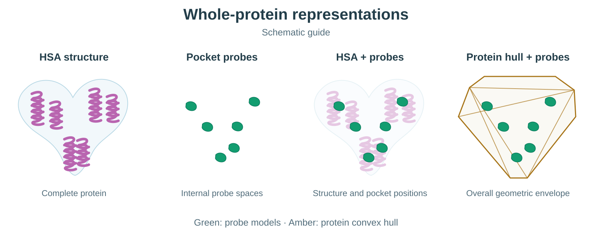
</picture>

<details>
<summary>Whole HSA - view all representations</summary>

<picture>
  <source media="(prefers-color-scheme: dark)" srcset="images/HSA_common_representative_dark.png">
  
</picture>

The structures are aligned on Domain II and shown at the same scale. The
cartoon shows secondary structure; colored probes mark the calculated cavity
spaces. The wireframe is the convex envelope of the complete protein.

| Contents | Dominant conformation, 68.3% | Alternative conformation, 31.7% |
|---|---|---|
| Protein atoms | [PDB](structures/representative/whole_protein/protein.pdb) | [PDB](structures/representative/whole_protein_group_2/protein.pdb) |
| Protein atoms and all pocket probes | [PDB](structures/representative/whole_protein/protein_with_probes.pdb) | [PDB](structures/representative/whole_protein_group_2/protein_with_probes.pdb) |
| Protein atoms, all probes and protein hull | [PDB](structures/representative/whole_protein/protein_with_probes_and_hull.pdb) | [PDB](structures/representative/whole_protein_group_2/protein_with_probes_and_hull.pdb) |
| Protein hull and all probes | [PDB](structures/representative/whole_protein/probes_protein_hull.pdb), [OBJ](structures/representative/whole_protein/probes_protein_hull.obj), [SDF](structures/representative/whole_protein/probes_protein_hull.sdf) | [PDB](structures/representative/whole_protein_group_2/probes_protein_hull.pdb), [OBJ](structures/representative/whole_protein_group_2/probes_protein_hull.obj), [SDF](structures/representative/whole_protein_group_2/probes_protein_hull.sdf) |
| All model files | [Folder](structures/representative/whole_protein) | [Folder](structures/representative/whole_protein_group_2) |

#### Dominant conformation - group 1

<picture>
  <source media="(prefers-color-scheme: dark)" srcset="images/HSA_group_1_representations_dark.png">
  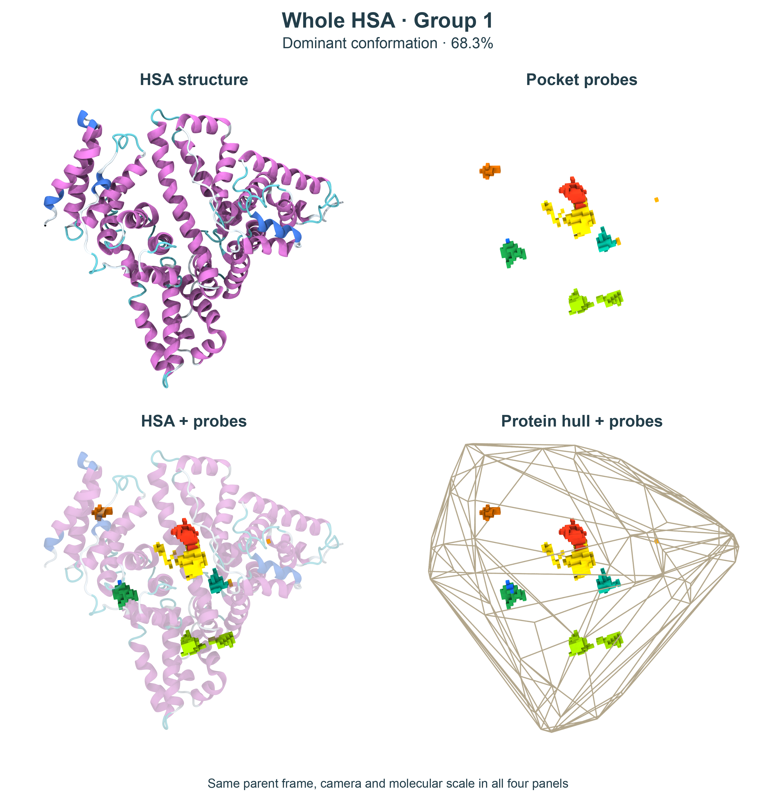
</picture>

#### Alternative conformation - group 2

<picture>
  <source media="(prefers-color-scheme: dark)" srcset="images/HSA_group_2_representations_dark.png">
  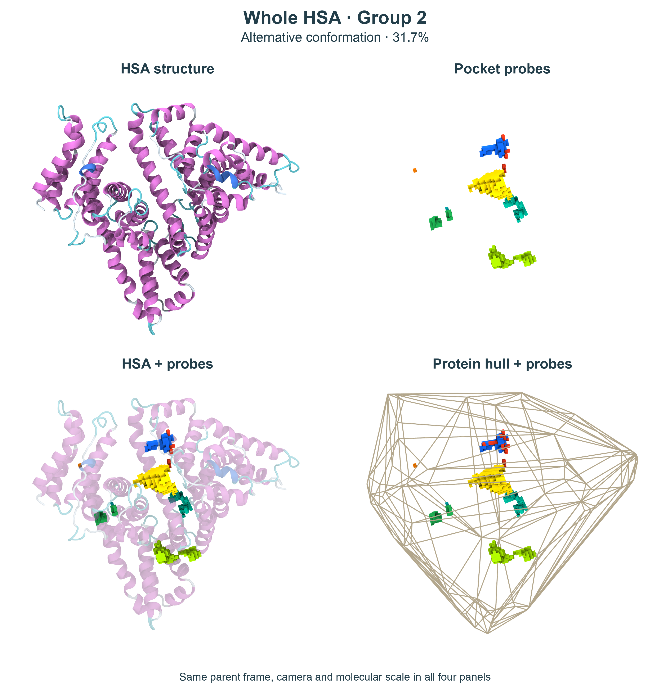
</picture>

Each gallery shows the selected protein, its eleven pocket probes, their
overlay and the complete protein hull at the same scale.

#### Protein solid with empty pockets

The full solid is the complete protein convex envelope minus the union of
the eleven probe spaces. Overlapping spaces are subtracted once.

The local solid contains one empty cavity and its surrounding material.
Its outer boundary is obtained by extending the convex envelope of the probe
by 10 Å and clipping it to the parent protein hull. These models are provided
as `pocket_solid.*` for every pocket and representative type.

<picture>
  <source media="(prefers-color-scheme: dark)" srcset="images/protein_solid_group_1_dark.png">
  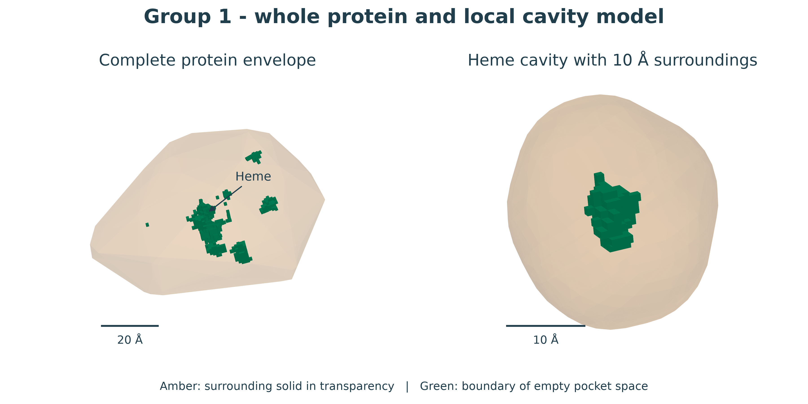
</picture>

<picture>
  <source media="(prefers-color-scheme: dark)" srcset="images/protein_solid_group_2_dark.png">
  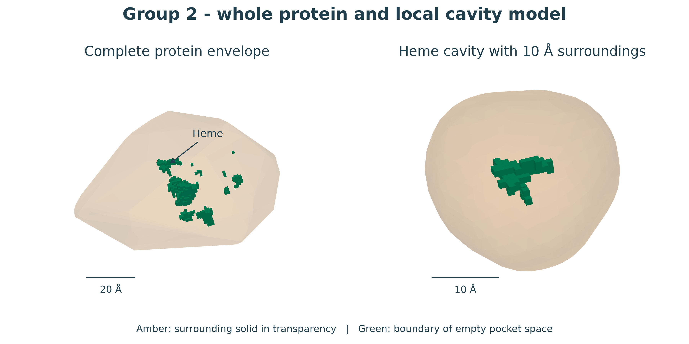
</picture>

Amber marks the surrounding solid; green marks the boundary of the empty
cavity. The enlarged panels show the heme pocket. Local models for all eleven
pockets are shown and linked in the individual pocket sections below.

| Contents | Dominant conformation | Alternative conformation |
|---|---|---|
| Protein solid with all pocket spaces removed | [OBJ](structures/representative/whole_protein/protein_solid.obj), [PDB](structures/representative/whole_protein/protein_solid.pdb), [SDF](structures/representative/whole_protein/protein_solid.sdf) | [OBJ](structures/representative/whole_protein_group_2/protein_solid.obj), [PDB](structures/representative/whole_protein_group_2/protein_solid.pdb), [SDF](structures/representative/whole_protein_group_2/protein_solid.sdf) |
| Combined empty pocket spaces | [OBJ](structures/representative/whole_protein/pocket_voids.obj), [PDB](structures/representative/whole_protein/pocket_voids.pdb), [SDF](structures/representative/whole_protein/pocket_voids.sdf) | [OBJ](structures/representative/whole_protein_group_2/pocket_voids.obj), [PDB](structures/representative/whole_protein_group_2/pocket_voids.pdb), [SDF](structures/representative/whole_protein_group_2/pocket_voids.sdf) |

These models also have PLY, MOL and MOL2 files. OBJ and PLY store triangular
surfaces; PDB stores mesh vertices and connections. Model volumes are listed in
[solid_models.csv](tables/solid_models.csv) and
[pocket_solid_models.csv](tables/pocket_solid_models.csv).

</details>

### Pocket-shape representatives

Each pocket-shape model contains the cavity selected by local shape clustering,
its lining residues and its complete source protein. Different pockets can
therefore come from different frames. These models are in
[`pocket_geometry/`](structures/representative/pocket_geometry).

The schematic shows the lining residues, probe space, their overlay and the
lining-residue convex hull. Green marks probe space; amber marks the hull.

<picture>
  <source media="(prefers-color-scheme: dark)" srcset="images/representations_overview_dark.svg">
  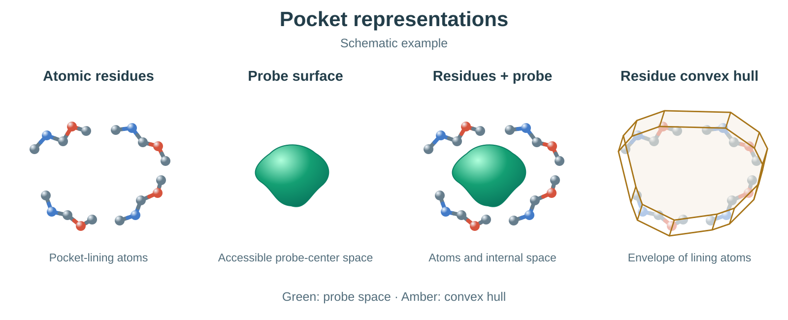
</picture>

Each pocket gallery compares the dominant protein frame, pocket-shape frame
and mean-volume frame after local alignment, at the same scale. The second
image shows the empty cavity and its 10 Å solid surroundings in all four
representative collections, including the alternative protein conformation.
A frame with no accessible probe space has an empty local model.

<details>
<summary>Sudlow I - view all representations</summary>

#### Sudlow I

<picture>
  <source media="(prefers-color-scheme: dark)" srcset="images/Sudlow_I_representatives_dark.png">
  
</picture>

<picture>
  <source media="(prefers-color-scheme: dark)" srcset="images/Sudlow_I_pocket_solid_dark.png">
  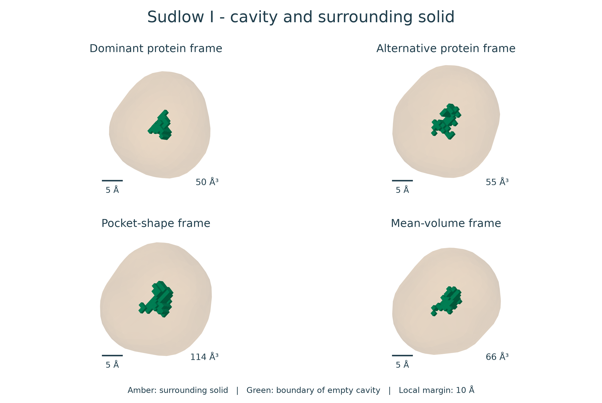
</picture>

| Frame selection | Atomic lining residues | Cavity with surrounding solid | All pocket models |
|---|---|---|---|
| Dominant protein frame | [PDB](structures/representative/whole_protein/Sudlow_I/residues.pdb) | [OBJ](structures/representative/whole_protein/Sudlow_I/pocket_solid.obj), [PDB](structures/representative/whole_protein/Sudlow_I/pocket_solid.pdb), [SDF](structures/representative/whole_protein/Sudlow_I/pocket_solid.sdf) | [Folder](structures/representative/whole_protein/Sudlow_I) |
| Alternative protein frame | [PDB](structures/representative/whole_protein_group_2/Sudlow_I/residues.pdb) | [OBJ](structures/representative/whole_protein_group_2/Sudlow_I/pocket_solid.obj), [PDB](structures/representative/whole_protein_group_2/Sudlow_I/pocket_solid.pdb), [SDF](structures/representative/whole_protein_group_2/Sudlow_I/pocket_solid.sdf) | [Folder](structures/representative/whole_protein_group_2/Sudlow_I) |
| Pocket-shape frame | [PDB](structures/representative/pocket_geometry/Sudlow_I/residues.pdb) | [OBJ](structures/representative/pocket_geometry/Sudlow_I/pocket_solid.obj), [PDB](structures/representative/pocket_geometry/Sudlow_I/pocket_solid.pdb), [SDF](structures/representative/pocket_geometry/Sudlow_I/pocket_solid.sdf) | [Folder](structures/representative/pocket_geometry/Sudlow_I) |
| Mean-volume frame | [PDB](structures/representative/mean_volume/Sudlow_I/residues.pdb) | [OBJ](structures/representative/mean_volume/Sudlow_I/pocket_solid.obj), [PDB](structures/representative/mean_volume/Sudlow_I/pocket_solid.pdb), [SDF](structures/representative/mean_volume/Sudlow_I/pocket_solid.sdf) | [Folder](structures/representative/mean_volume/Sudlow_I) |

</details>

<details>
<summary>Sudlow II - view all representations</summary>

#### Sudlow II

<picture>
  <source media="(prefers-color-scheme: dark)" srcset="images/Sudlow_II_representatives_dark.png">
  
</picture>

<picture>
  <source media="(prefers-color-scheme: dark)" srcset="images/Sudlow_II_pocket_solid_dark.png">
  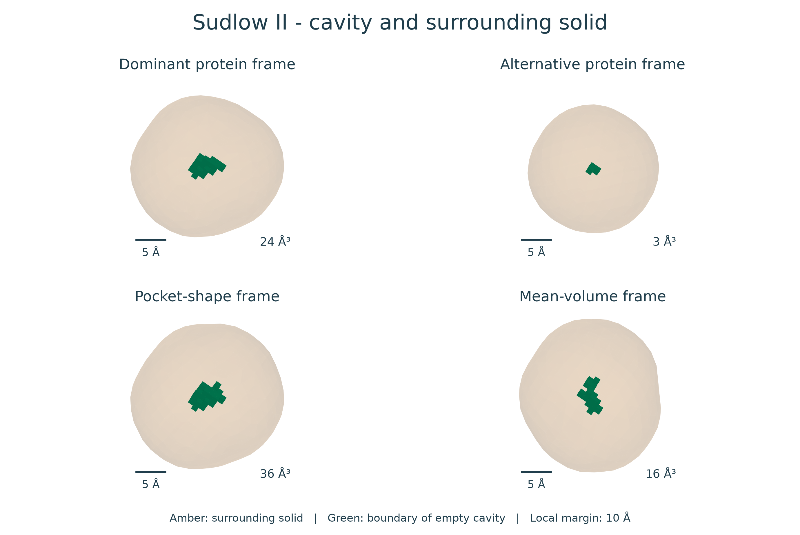
</picture>

| Frame selection | Atomic lining residues | Cavity with surrounding solid | All pocket models |
|---|---|---|---|
| Dominant protein frame | [PDB](structures/representative/whole_protein/Sudlow_II/residues.pdb) | [OBJ](structures/representative/whole_protein/Sudlow_II/pocket_solid.obj), [PDB](structures/representative/whole_protein/Sudlow_II/pocket_solid.pdb), [SDF](structures/representative/whole_protein/Sudlow_II/pocket_solid.sdf) | [Folder](structures/representative/whole_protein/Sudlow_II) |
| Alternative protein frame | [PDB](structures/representative/whole_protein_group_2/Sudlow_II/residues.pdb) | [OBJ](structures/representative/whole_protein_group_2/Sudlow_II/pocket_solid.obj), [PDB](structures/representative/whole_protein_group_2/Sudlow_II/pocket_solid.pdb), [SDF](structures/representative/whole_protein_group_2/Sudlow_II/pocket_solid.sdf) | [Folder](structures/representative/whole_protein_group_2/Sudlow_II) |
| Pocket-shape frame | [PDB](structures/representative/pocket_geometry/Sudlow_II/residues.pdb) | [OBJ](structures/representative/pocket_geometry/Sudlow_II/pocket_solid.obj), [PDB](structures/representative/pocket_geometry/Sudlow_II/pocket_solid.pdb), [SDF](structures/representative/pocket_geometry/Sudlow_II/pocket_solid.sdf) | [Folder](structures/representative/pocket_geometry/Sudlow_II) |
| Mean-volume frame | [PDB](structures/representative/mean_volume/Sudlow_II/residues.pdb) | [OBJ](structures/representative/mean_volume/Sudlow_II/pocket_solid.obj), [PDB](structures/representative/mean_volume/Sudlow_II/pocket_solid.pdb), [SDF](structures/representative/mean_volume/Sudlow_II/pocket_solid.sdf) | [Folder](structures/representative/mean_volume/Sudlow_II) |

</details>

<details>
<summary>Heme - view all representations</summary>

#### Heme

<picture>
  <source media="(prefers-color-scheme: dark)" srcset="images/Heme_representatives_dark.png">
  
</picture>

<picture>
  <source media="(prefers-color-scheme: dark)" srcset="images/Heme_pocket_solid_dark.png">
  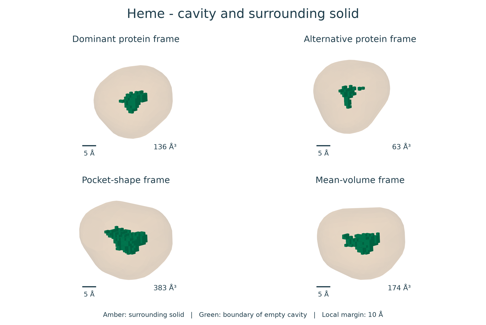
</picture>

| Frame selection | Atomic lining residues | Cavity with surrounding solid | All pocket models |
|---|---|---|---|
| Dominant protein frame | [PDB](structures/representative/whole_protein/Heme/residues.pdb) | [OBJ](structures/representative/whole_protein/Heme/pocket_solid.obj), [PDB](structures/representative/whole_protein/Heme/pocket_solid.pdb), [SDF](structures/representative/whole_protein/Heme/pocket_solid.sdf) | [Folder](structures/representative/whole_protein/Heme) |
| Alternative protein frame | [PDB](structures/representative/whole_protein_group_2/Heme/residues.pdb) | [OBJ](structures/representative/whole_protein_group_2/Heme/pocket_solid.obj), [PDB](structures/representative/whole_protein_group_2/Heme/pocket_solid.pdb), [SDF](structures/representative/whole_protein_group_2/Heme/pocket_solid.sdf) | [Folder](structures/representative/whole_protein_group_2/Heme) |
| Pocket-shape frame | [PDB](structures/representative/pocket_geometry/Heme/residues.pdb) | [OBJ](structures/representative/pocket_geometry/Heme/pocket_solid.obj), [PDB](structures/representative/pocket_geometry/Heme/pocket_solid.pdb), [SDF](structures/representative/pocket_geometry/Heme/pocket_solid.sdf) | [Folder](structures/representative/pocket_geometry/Heme) |
| Mean-volume frame | [PDB](structures/representative/mean_volume/Heme/residues.pdb) | [OBJ](structures/representative/mean_volume/Heme/pocket_solid.obj), [PDB](structures/representative/mean_volume/Heme/pocket_solid.pdb), [SDF](structures/representative/mean_volume/Heme/pocket_solid.sdf) | [Folder](structures/representative/mean_volume/Heme) |

</details>

<details>
<summary>Cleft - view all representations</summary>

#### Cleft

<picture>
  <source media="(prefers-color-scheme: dark)" srcset="images/Cleft_representatives_dark.png">
  
</picture>

<picture>
  <source media="(prefers-color-scheme: dark)" srcset="images/Cleft_pocket_solid_dark.png">
  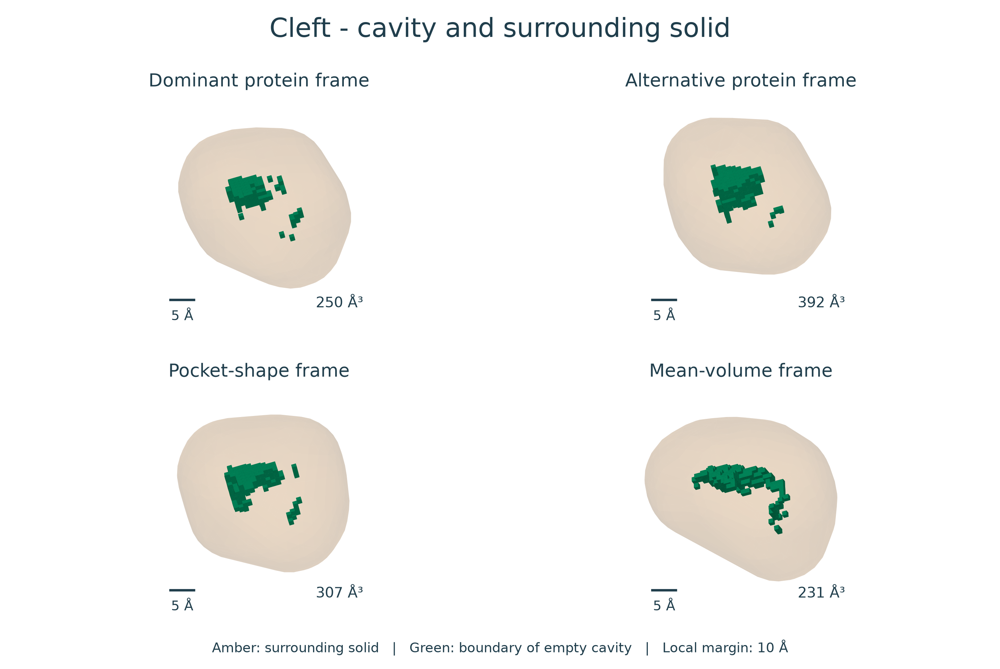
</picture>

| Frame selection | Atomic lining residues | Cavity with surrounding solid | All pocket models |
|---|---|---|---|
| Dominant protein frame | [PDB](structures/representative/whole_protein/Cleft/residues.pdb) | [OBJ](structures/representative/whole_protein/Cleft/pocket_solid.obj), [PDB](structures/representative/whole_protein/Cleft/pocket_solid.pdb), [SDF](structures/representative/whole_protein/Cleft/pocket_solid.sdf) | [Folder](structures/representative/whole_protein/Cleft) |
| Alternative protein frame | [PDB](structures/representative/whole_protein_group_2/Cleft/residues.pdb) | [OBJ](structures/representative/whole_protein_group_2/Cleft/pocket_solid.obj), [PDB](structures/representative/whole_protein_group_2/Cleft/pocket_solid.pdb), [SDF](structures/representative/whole_protein_group_2/Cleft/pocket_solid.sdf) | [Folder](structures/representative/whole_protein_group_2/Cleft) |
| Pocket-shape frame | [PDB](structures/representative/pocket_geometry/Cleft/residues.pdb) | [OBJ](structures/representative/pocket_geometry/Cleft/pocket_solid.obj), [PDB](structures/representative/pocket_geometry/Cleft/pocket_solid.pdb), [SDF](structures/representative/pocket_geometry/Cleft/pocket_solid.sdf) | [Folder](structures/representative/pocket_geometry/Cleft) |
| Mean-volume frame | [PDB](structures/representative/mean_volume/Cleft/residues.pdb) | [OBJ](structures/representative/mean_volume/Cleft/pocket_solid.obj), [PDB](structures/representative/mean_volume/Cleft/pocket_solid.pdb), [SDF](structures/representative/mean_volume/Cleft/pocket_solid.sdf) | [Folder](structures/representative/mean_volume/Cleft) |

</details>

<details>
<summary>FA1 - view all representations</summary>

#### FA1

<picture>
  <source media="(prefers-color-scheme: dark)" srcset="images/FA1_representatives_dark.png">
  
</picture>

<picture>
  <source media="(prefers-color-scheme: dark)" srcset="images/FA1_pocket_solid_dark.png">
  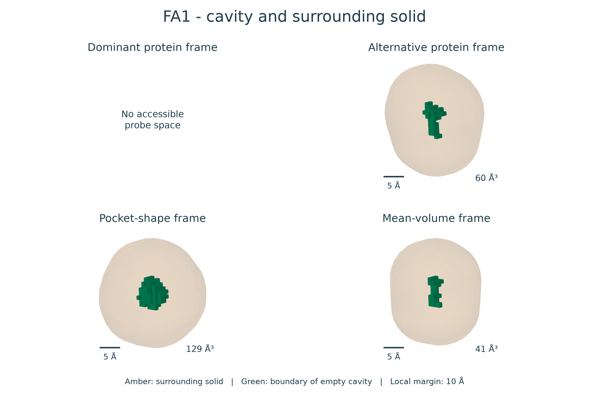
</picture>

| Frame selection | Atomic lining residues | Cavity with surrounding solid | All pocket models |
|---|---|---|---|
| Dominant protein frame | [PDB](structures/representative/whole_protein/FA1/residues.pdb) | [OBJ](structures/representative/whole_protein/FA1/pocket_solid.obj), [PDB](structures/representative/whole_protein/FA1/pocket_solid.pdb), [SDF](structures/representative/whole_protein/FA1/pocket_solid.sdf) | [Folder](structures/representative/whole_protein/FA1) |
| Alternative protein frame | [PDB](structures/representative/whole_protein_group_2/FA1/residues.pdb) | [OBJ](structures/representative/whole_protein_group_2/FA1/pocket_solid.obj), [PDB](structures/representative/whole_protein_group_2/FA1/pocket_solid.pdb), [SDF](structures/representative/whole_protein_group_2/FA1/pocket_solid.sdf) | [Folder](structures/representative/whole_protein_group_2/FA1) |
| Pocket-shape frame | [PDB](structures/representative/pocket_geometry/FA1/residues.pdb) | [OBJ](structures/representative/pocket_geometry/FA1/pocket_solid.obj), [PDB](structures/representative/pocket_geometry/FA1/pocket_solid.pdb), [SDF](structures/representative/pocket_geometry/FA1/pocket_solid.sdf) | [Folder](structures/representative/pocket_geometry/FA1) |
| Mean-volume frame | [PDB](structures/representative/mean_volume/FA1/residues.pdb) | [OBJ](structures/representative/mean_volume/FA1/pocket_solid.obj), [PDB](structures/representative/mean_volume/FA1/pocket_solid.pdb), [SDF](structures/representative/mean_volume/FA1/pocket_solid.sdf) | [Folder](structures/representative/mean_volume/FA1) |

</details>

<details>
<summary>FA2 - view all representations</summary>

#### FA2

<picture>
  <source media="(prefers-color-scheme: dark)" srcset="images/FA2_representatives_dark.png">
  
</picture>

<picture>
  <source media="(prefers-color-scheme: dark)" srcset="images/FA2_pocket_solid_dark.png">
  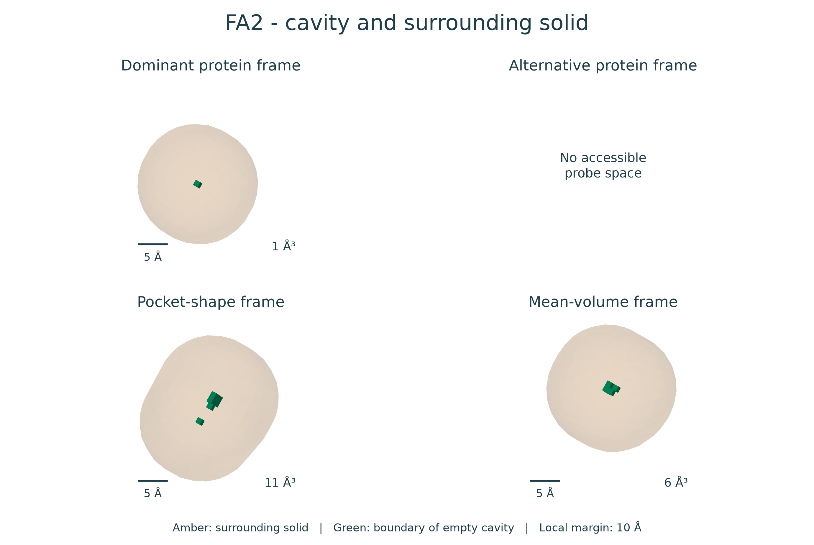
</picture>

| Frame selection | Atomic lining residues | Cavity with surrounding solid | All pocket models |
|---|---|---|---|
| Dominant protein frame | [PDB](structures/representative/whole_protein/FA2/residues.pdb) | [OBJ](structures/representative/whole_protein/FA2/pocket_solid.obj), [PDB](structures/representative/whole_protein/FA2/pocket_solid.pdb), [SDF](structures/representative/whole_protein/FA2/pocket_solid.sdf) | [Folder](structures/representative/whole_protein/FA2) |
| Alternative protein frame | [PDB](structures/representative/whole_protein_group_2/FA2/residues.pdb) | [OBJ](structures/representative/whole_protein_group_2/FA2/pocket_solid.obj), [PDB](structures/representative/whole_protein_group_2/FA2/pocket_solid.pdb), [SDF](structures/representative/whole_protein_group_2/FA2/pocket_solid.sdf) | [Folder](structures/representative/whole_protein_group_2/FA2) |
| Pocket-shape frame | [PDB](structures/representative/pocket_geometry/FA2/residues.pdb) | [OBJ](structures/representative/pocket_geometry/FA2/pocket_solid.obj), [PDB](structures/representative/pocket_geometry/FA2/pocket_solid.pdb), [SDF](structures/representative/pocket_geometry/FA2/pocket_solid.sdf) | [Folder](structures/representative/pocket_geometry/FA2) |
| Mean-volume frame | [PDB](structures/representative/mean_volume/FA2/residues.pdb) | [OBJ](structures/representative/mean_volume/FA2/pocket_solid.obj), [PDB](structures/representative/mean_volume/FA2/pocket_solid.pdb), [SDF](structures/representative/mean_volume/FA2/pocket_solid.sdf) | [Folder](structures/representative/mean_volume/FA2) |

</details>

<details>
<summary>FA3 - view all representations</summary>

#### FA3

<picture>
  <source media="(prefers-color-scheme: dark)" srcset="images/FA3_representatives_dark.png">
  
</picture>

<picture>
  <source media="(prefers-color-scheme: dark)" srcset="images/FA3_pocket_solid_dark.png">
  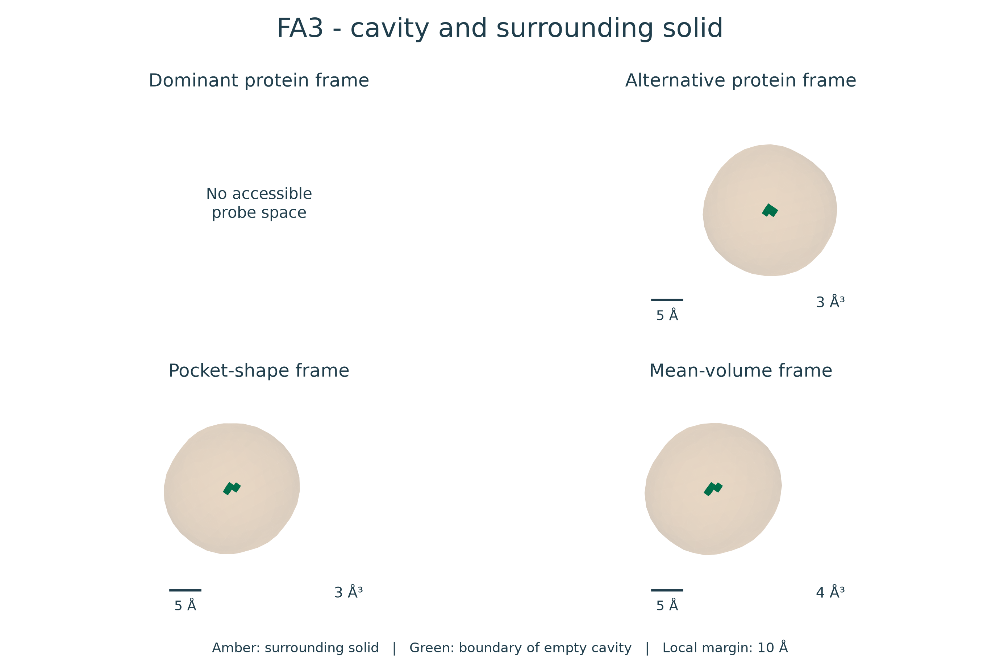
</picture>

| Frame selection | Atomic lining residues | Cavity with surrounding solid | All pocket models |
|---|---|---|---|
| Dominant protein frame | [PDB](structures/representative/whole_protein/FA3/residues.pdb) | [OBJ](structures/representative/whole_protein/FA3/pocket_solid.obj), [PDB](structures/representative/whole_protein/FA3/pocket_solid.pdb), [SDF](structures/representative/whole_protein/FA3/pocket_solid.sdf) | [Folder](structures/representative/whole_protein/FA3) |
| Alternative protein frame | [PDB](structures/representative/whole_protein_group_2/FA3/residues.pdb) | [OBJ](structures/representative/whole_protein_group_2/FA3/pocket_solid.obj), [PDB](structures/representative/whole_protein_group_2/FA3/pocket_solid.pdb), [SDF](structures/representative/whole_protein_group_2/FA3/pocket_solid.sdf) | [Folder](structures/representative/whole_protein_group_2/FA3) |
| Pocket-shape frame | [PDB](structures/representative/pocket_geometry/FA3/residues.pdb) | [OBJ](structures/representative/pocket_geometry/FA3/pocket_solid.obj), [PDB](structures/representative/pocket_geometry/FA3/pocket_solid.pdb), [SDF](structures/representative/pocket_geometry/FA3/pocket_solid.sdf) | [Folder](structures/representative/pocket_geometry/FA3) |
| Mean-volume frame | [PDB](structures/representative/mean_volume/FA3/residues.pdb) | [OBJ](structures/representative/mean_volume/FA3/pocket_solid.obj), [PDB](structures/representative/mean_volume/FA3/pocket_solid.pdb), [SDF](structures/representative/mean_volume/FA3/pocket_solid.sdf) | [Folder](structures/representative/mean_volume/FA3) |

</details>

<details>
<summary>FA4 - view all representations</summary>

#### FA4

<picture>
  <source media="(prefers-color-scheme: dark)" srcset="images/FA4_representatives_dark.png">
  
</picture>

<picture>
  <source media="(prefers-color-scheme: dark)" srcset="images/FA4_pocket_solid_dark.png">
  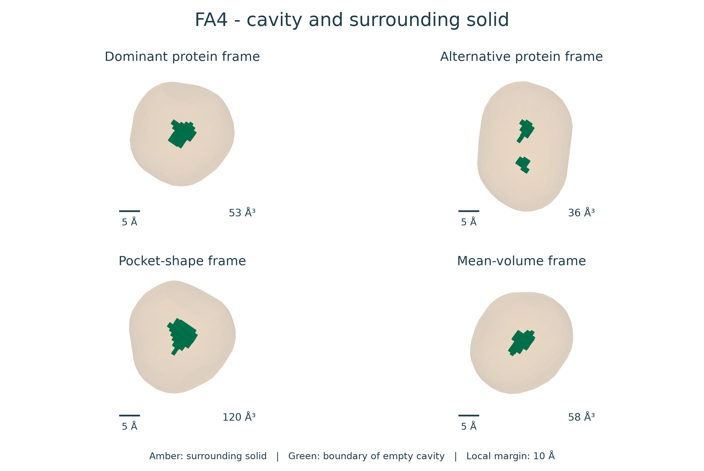
</picture>

| Frame selection | Atomic lining residues | Cavity with surrounding solid | All pocket models |
|---|---|---|---|
| Dominant protein frame | [PDB](structures/representative/whole_protein/FA4/residues.pdb) | [OBJ](structures/representative/whole_protein/FA4/pocket_solid.obj), [PDB](structures/representative/whole_protein/FA4/pocket_solid.pdb), [SDF](structures/representative/whole_protein/FA4/pocket_solid.sdf) | [Folder](structures/representative/whole_protein/FA4) |
| Alternative protein frame | [PDB](structures/representative/whole_protein_group_2/FA4/residues.pdb) | [OBJ](structures/representative/whole_protein_group_2/FA4/pocket_solid.obj), [PDB](structures/representative/whole_protein_group_2/FA4/pocket_solid.pdb), [SDF](structures/representative/whole_protein_group_2/FA4/pocket_solid.sdf) | [Folder](structures/representative/whole_protein_group_2/FA4) |
| Pocket-shape frame | [PDB](structures/representative/pocket_geometry/FA4/residues.pdb) | [OBJ](structures/representative/pocket_geometry/FA4/pocket_solid.obj), [PDB](structures/representative/pocket_geometry/FA4/pocket_solid.pdb), [SDF](structures/representative/pocket_geometry/FA4/pocket_solid.sdf) | [Folder](structures/representative/pocket_geometry/FA4) |
| Mean-volume frame | [PDB](structures/representative/mean_volume/FA4/residues.pdb) | [OBJ](structures/representative/mean_volume/FA4/pocket_solid.obj), [PDB](structures/representative/mean_volume/FA4/pocket_solid.pdb), [SDF](structures/representative/mean_volume/FA4/pocket_solid.sdf) | [Folder](structures/representative/mean_volume/FA4) |

</details>

<details>
<summary>FA5 - view all representations</summary>

#### FA5

<picture>
  <source media="(prefers-color-scheme: dark)" srcset="images/FA5_representatives_dark.png">
  
</picture>

<picture>
  <source media="(prefers-color-scheme: dark)" srcset="images/FA5_pocket_solid_dark.png">
  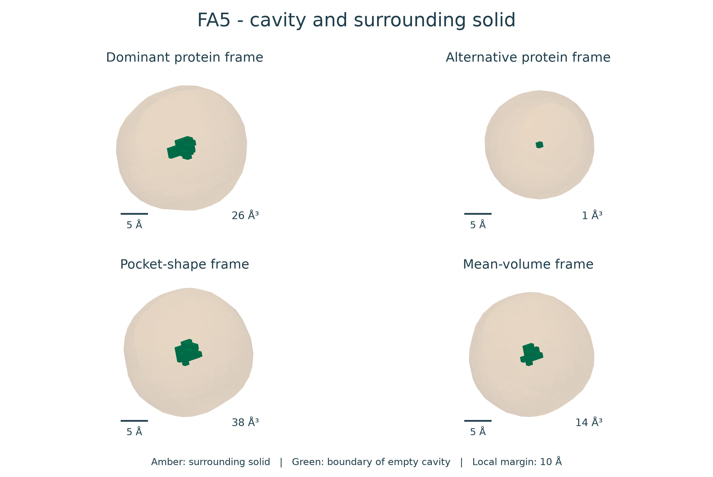
</picture>

| Frame selection | Atomic lining residues | Cavity with surrounding solid | All pocket models |
|---|---|---|---|
| Dominant protein frame | [PDB](structures/representative/whole_protein/FA5/residues.pdb) | [OBJ](structures/representative/whole_protein/FA5/pocket_solid.obj), [PDB](structures/representative/whole_protein/FA5/pocket_solid.pdb), [SDF](structures/representative/whole_protein/FA5/pocket_solid.sdf) | [Folder](structures/representative/whole_protein/FA5) |
| Alternative protein frame | [PDB](structures/representative/whole_protein_group_2/FA5/residues.pdb) | [OBJ](structures/representative/whole_protein_group_2/FA5/pocket_solid.obj), [PDB](structures/representative/whole_protein_group_2/FA5/pocket_solid.pdb), [SDF](structures/representative/whole_protein_group_2/FA5/pocket_solid.sdf) | [Folder](structures/representative/whole_protein_group_2/FA5) |
| Pocket-shape frame | [PDB](structures/representative/pocket_geometry/FA5/residues.pdb) | [OBJ](structures/representative/pocket_geometry/FA5/pocket_solid.obj), [PDB](structures/representative/pocket_geometry/FA5/pocket_solid.pdb), [SDF](structures/representative/pocket_geometry/FA5/pocket_solid.sdf) | [Folder](structures/representative/pocket_geometry/FA5) |
| Mean-volume frame | [PDB](structures/representative/mean_volume/FA5/residues.pdb) | [OBJ](structures/representative/mean_volume/FA5/pocket_solid.obj), [PDB](structures/representative/mean_volume/FA5/pocket_solid.pdb), [SDF](structures/representative/mean_volume/FA5/pocket_solid.sdf) | [Folder](structures/representative/mean_volume/FA5) |

</details>

<details>
<summary>FA6 - view all representations</summary>

#### FA6

<picture>
  <source media="(prefers-color-scheme: dark)" srcset="images/FA6_representatives_dark.png">
  
</picture>

<picture>
  <source media="(prefers-color-scheme: dark)" srcset="images/FA6_pocket_solid_dark.png">
  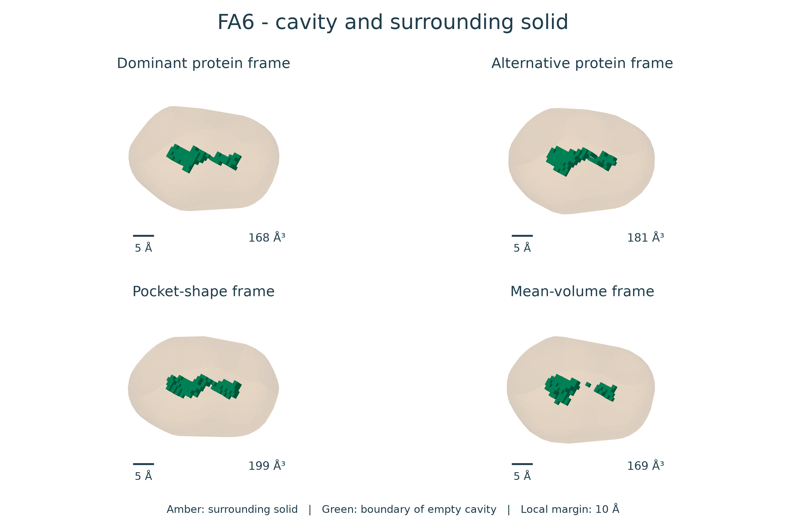
</picture>

| Frame selection | Atomic lining residues | Cavity with surrounding solid | All pocket models |
|---|---|---|---|
| Dominant protein frame | [PDB](structures/representative/whole_protein/FA6/residues.pdb) | [OBJ](structures/representative/whole_protein/FA6/pocket_solid.obj), [PDB](structures/representative/whole_protein/FA6/pocket_solid.pdb), [SDF](structures/representative/whole_protein/FA6/pocket_solid.sdf) | [Folder](structures/representative/whole_protein/FA6) |
| Alternative protein frame | [PDB](structures/representative/whole_protein_group_2/FA6/residues.pdb) | [OBJ](structures/representative/whole_protein_group_2/FA6/pocket_solid.obj), [PDB](structures/representative/whole_protein_group_2/FA6/pocket_solid.pdb), [SDF](structures/representative/whole_protein_group_2/FA6/pocket_solid.sdf) | [Folder](structures/representative/whole_protein_group_2/FA6) |
| Pocket-shape frame | [PDB](structures/representative/pocket_geometry/FA6/residues.pdb) | [OBJ](structures/representative/pocket_geometry/FA6/pocket_solid.obj), [PDB](structures/representative/pocket_geometry/FA6/pocket_solid.pdb), [SDF](structures/representative/pocket_geometry/FA6/pocket_solid.sdf) | [Folder](structures/representative/pocket_geometry/FA6) |
| Mean-volume frame | [PDB](structures/representative/mean_volume/FA6/residues.pdb) | [OBJ](structures/representative/mean_volume/FA6/pocket_solid.obj), [PDB](structures/representative/mean_volume/FA6/pocket_solid.pdb), [SDF](structures/representative/mean_volume/FA6/pocket_solid.sdf) | [Folder](structures/representative/mean_volume/FA6) |

</details>

<details>
<summary>FA7 - view all representations</summary>

#### FA7

<picture>
  <source media="(prefers-color-scheme: dark)" srcset="images/FA7_representatives_dark.png">
  
</picture>

<picture>
  <source media="(prefers-color-scheme: dark)" srcset="images/FA7_pocket_solid_dark.png">
  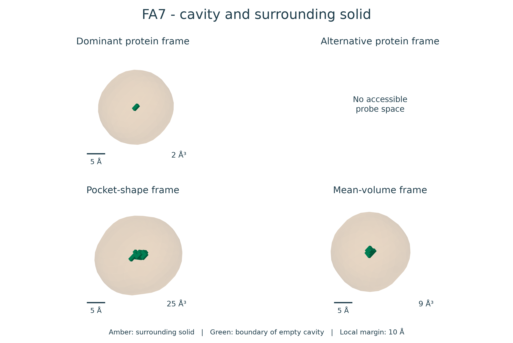
</picture>

| Frame selection | Atomic lining residues | Cavity with surrounding solid | All pocket models |
|---|---|---|---|
| Dominant protein frame | [PDB](structures/representative/whole_protein/FA7/residues.pdb) | [OBJ](structures/representative/whole_protein/FA7/pocket_solid.obj), [PDB](structures/representative/whole_protein/FA7/pocket_solid.pdb), [SDF](structures/representative/whole_protein/FA7/pocket_solid.sdf) | [Folder](structures/representative/whole_protein/FA7) |
| Alternative protein frame | [PDB](structures/representative/whole_protein_group_2/FA7/residues.pdb) | [OBJ](structures/representative/whole_protein_group_2/FA7/pocket_solid.obj), [PDB](structures/representative/whole_protein_group_2/FA7/pocket_solid.pdb), [SDF](structures/representative/whole_protein_group_2/FA7/pocket_solid.sdf) | [Folder](structures/representative/whole_protein_group_2/FA7) |
| Pocket-shape frame | [PDB](structures/representative/pocket_geometry/FA7/residues.pdb) | [OBJ](structures/representative/pocket_geometry/FA7/pocket_solid.obj), [PDB](structures/representative/pocket_geometry/FA7/pocket_solid.pdb), [SDF](structures/representative/pocket_geometry/FA7/pocket_solid.sdf) | [Folder](structures/representative/pocket_geometry/FA7) |
| Mean-volume frame | [PDB](structures/representative/mean_volume/FA7/residues.pdb) | [OBJ](structures/representative/mean_volume/FA7/pocket_solid.obj), [PDB](structures/representative/mean_volume/FA7/pocket_solid.pdb), [SDF](structures/representative/mean_volume/FA7/pocket_solid.sdf) | [Folder](structures/representative/mean_volume/FA7) |

</details>

## Pocket volumes

**MD mean ± SD** reports the average of the three replica means and their
between-replica SD. Each replica mean includes all 102 sampled observations,
including frames with zero accessible probe space.

**Dominant protein** and **Alternative protein** give the volumes in the two
whole-protein frames.
**Pocket shape** gives the volume in the frame selected by cavity geometry.
These selection criteria describe protein opening or local shape, so their
volumes can differ from the ensemble mean.

**Mean volume** gives the cavity volume in the observed frame closest to the
MD mean among the 306 sampled frames. Its model is in
[`mean_volume/`](structures/representative/mean_volume). All volumes are in ų;
each linked value opens the corresponding model folder.

| Pocket | MD mean ± SD | Dominant protein | Alternative protein | Pocket shape | Mean volume |
|---|---:|---:|---:|---:|---:|
| Sudlow&nbsp;I | 65.9 ± 13.4 | [50](structures/representative/whole_protein/Sudlow_I) | [55](structures/representative/whole_protein_group_2/Sudlow_I) | [114](structures/representative/pocket_geometry/Sudlow_I) | [66](structures/representative/mean_volume/Sudlow_I) |
| Sudlow&nbsp;II | 16.4 ± 10.6 | [24](structures/representative/whole_protein/Sudlow_II) | [3](structures/representative/whole_protein_group_2/Sudlow_II) | [36](structures/representative/pocket_geometry/Sudlow_II) | [16](structures/representative/mean_volume/Sudlow_II) |
| Heme | 173.5 ± 36.9 | [136](structures/representative/whole_protein/Heme) | [63](structures/representative/whole_protein_group_2/Heme) | [383](structures/representative/pocket_geometry/Heme) | [174](structures/representative/mean_volume/Heme) |
| Cleft | 233.5 ± 103.8 | [250](structures/representative/whole_protein/Cleft) | [392](structures/representative/whole_protein_group_2/Cleft) | [307](structures/representative/pocket_geometry/Cleft) | [231](structures/representative/mean_volume/Cleft) |
| FA1 | 41.0 ± 13.1 | [0](structures/representative/whole_protein/FA1) | [60](structures/representative/whole_protein_group_2/FA1) | [129](structures/representative/pocket_geometry/FA1) | [41](structures/representative/mean_volume/FA1) |
| FA2 | 5.7 ± 4.6 | [1](structures/representative/whole_protein/FA2) | [0](structures/representative/whole_protein_group_2/FA2) | [11](structures/representative/pocket_geometry/FA2) | [6](structures/representative/mean_volume/FA2) |
| FA3 | 4.2 ± 4.4 | [0](structures/representative/whole_protein/FA3) | [3](structures/representative/whole_protein_group_2/FA3) | [3](structures/representative/pocket_geometry/FA3) | [4](structures/representative/mean_volume/FA3) |
| FA4 | 57.9 ± 33.2 | [53](structures/representative/whole_protein/FA4) | [36](structures/representative/whole_protein_group_2/FA4) | [120](structures/representative/pocket_geometry/FA4) | [58](structures/representative/mean_volume/FA4) |
| FA5 | 14.1 ± 15.0 | [26](structures/representative/whole_protein/FA5) | [1](structures/representative/whole_protein_group_2/FA5) | [38](structures/representative/pocket_geometry/FA5) | [14](structures/representative/mean_volume/FA5) |
| FA6 | 169.1 ± 24.5 | [168](structures/representative/whole_protein/FA6) | [181](structures/representative/whole_protein_group_2/FA6) | [199](structures/representative/pocket_geometry/FA6) | [169](structures/representative/mean_volume/FA6) |
| FA7 | 9.3 ± 5.5 | [2](structures/representative/whole_protein/FA7) | [0](structures/representative/whole_protein_group_2/FA7) | [25](structures/representative/pocket_geometry/FA7) | [9](structures/representative/mean_volume/FA7) |

A zero means that the 1.4 Å probe has no accessible center positions within
the specified region in that frame. The physiological site is still defined by
its reference residues. These volumes describe the selected probe and region;
FA7 overlaps Sudlow I, and FA3/FA4 overlap Sudlow II.

- [Full comparison table](tables/representative_comparison.csv)
- [Source frames and lining residues](tables/representative_models.csv)
- [Mean-volume frames](tables/mean_volume_models.csv)
- [Methods and table definitions](tables/README.md)

## Find the files

```text
structures/
├── representative/
│   ├── whole_protein/          Dominant protein frame
│   ├── whole_protein_group_2/  Alternative protein frame
│   ├── pocket_geometry/        One shape-selected frame per pocket
│   └── mean_volume/            One frame near each mean pocket volume
├── R1/                        Original per-replica representatives
├── R2/
└── R3/
tables/                        Volumes, source frames and methods
images/                        Transparent previews
```

Inside `R1/`, `R2/` and `R3/`, `cluster_1/` and `cluster_2/` contain
representatives of the same common protein groups, selected within each replica.
In `whole_protein/` and `whole_protein_group_2/`, each named pocket folder uses
the parent protein frame. In `pocket_geometry/` and `mean_volume/`, each pocket
folder also contains its own complete parent protein. All coordinates are in Å.

### Four components

| Name | Contents |
|---|---|
| `residues` | Complete lining residues with heavy atoms within 4 Å of a probe-mesh vertex |
| `probe` | Internal space accessible to the center of a 1.4 Å probe |
| `hull` | Convex envelope of the lining-residue heavy atoms |
| `protein_hull` | Convex envelope of the complete parent HSA |
| `anchors.pdb` | Fixed reference residues used to locate and align the physiological region |

`residues.pdb` follows the cavity boundary in the selected frame.
`anchors.pdb` contains the alignment reference for that region; the two
selections can differ. The probe measures cavity space. The pocket hull
encloses the surrounding atoms, so its volume is different from the probe volume.

### All component combinations

Every pocket folder contains all fifteen nonempty combinations of the four
components as PDB files. `both_hulls` means the pocket hull and the complete
protein hull together. Filenames use letters, numbers and underscores.

| Components | File stem |
|---|---|
| Residues | `residues` |
| Probe | `probe` |
| Pocket hull | `hull` |
| Protein hull | `protein_hull` |
| Residues + probe | `residues_probe` |
| Residues + pocket hull | `residues_hull` |
| Residues + protein hull | `residues_protein_hull` |
| Probe + pocket hull | `probe_hull` |
| Probe + protein hull | `probe_protein_hull` |
| Both hulls | `both_hulls` |
| Residues + probe + pocket hull | `residues_probe_hull` |
| Residues + probe + protein hull | `residues_probe_protein_hull` |
| Residues + both hulls | `residues_both_hulls` |
| Probe + both hulls | `probe_both_hulls` |
| Residues + probe + both hulls | `residues_probe_both_hulls` |

The seven combinations containing only geometry also have OBJ, PLY, MOL, SDF
and MOL2 exports. MOL/SDF/MOL2 encode mesh vertices as virtual atoms and edges
as geometric links. These files retain the cavity geometry for shape processing;
the chemical atoms and residue identities are in the atomic PDB files.
An empty probe file records a frame in which no space fits the selected probe.

### Complete protein models

| File | Contents |
|---|---|
| `protein.pdb` | Complete atomic parent protein |
| `protein_with_hull.pdb` | Protein atoms and complete protein hull |
| `protein_with_probe.pdb` | Protein atoms and one pocket probe; inside each pocket folder |
| `protein_with_probe_and_hull.pdb` | Protein atoms, one pocket probe and complete protein hull |
| `probes.*` | All eleven probe meshes from one coherent protein frame |
| `protein_with_probes.pdb` | Protein atoms and all eleven probes |
| `probes_protein_hull.*` | All probes and the complete protein hull |
| `protein_with_probes_and_hull.pdb` | Protein atoms, all probes and protein hull |
| `protein_solid.*` | Filled protein hull with the probe union removed |
| `pocket_solid.*` | One empty cavity with rounded 10 Å solid surroundings; inside each pocket folder |
| `pocket_voids.*` | The union removed from the inverse solid |

Local solids are available for all nonempty pockets in every model collection.
An empty local file records a frame with no accessible probe space.

The complete all-pocket models are in the two `whole_protein` folders and the
six `R1`-`R3` group folders. All fifteen pocket combinations and their paths
are listed in [model_files.csv](tables/model_files.csv).
Frame selections, clustering comparisons and table definitions are in
[Methods and numerical results](tables/README.md).

## License

The original structures, geometric models, numerical tables, figures and
documentation in this collection are licensed under
[Creative Commons Attribution 4.0 International (CC BY 4.0)](LICENSE).

Reuse and adaptation, including commercial use, are permitted with appropriate
credit, a link to the license and an indication of any changes. Please identify
this collection and retain the author and source information supplied with
the material.

Third-party material retains its original terms and attribution.
