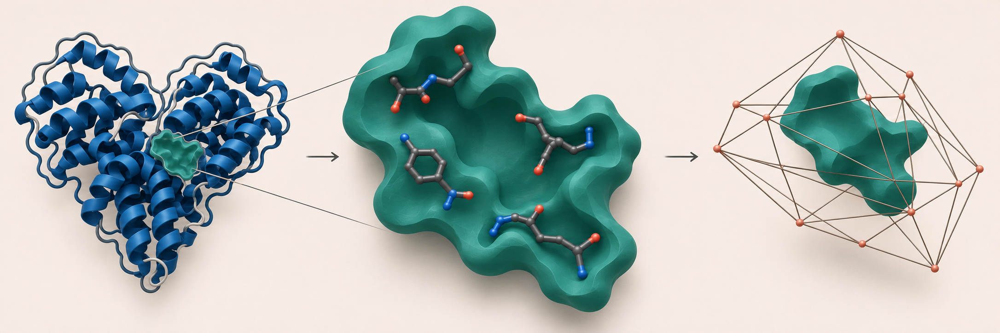

<h1 align="center">Native HSA physiological pockets</h1>

Atomic structures and geometric models of eleven physiological regions
in native human serum albumin.

<p align="center">
  <a href="https://doi.org/10.5281/zenodo.24119580"></a>
  <a href="LICENSE"></a>
</p>

<picture>
  <source media="(prefers-color-scheme: dark)" srcset="images/banner_dark.png">
  
</picture>

## Contents

- [Getting started](#getting-started)
- [Usage and examples](#usage-and-examples)
- [Data and files](#data-and-files)
- [Methods and validation](#methods-and-validation)
- [Documentation](#documentation)
- [Citation](#citation)
- [Contributing](#contributing)
- [Acknowledgements](#acknowledgements)
- [License](#license)

## Getting started

Choose a collection according to the model you need:

| What you need | Collection |
|---|---|
| All pockets in one coherent protein frame | [Dominant whole-protein representative](structures/representative/whole_protein/) |
| The second common protein conformation | [Alternative whole-protein representative](structures/representative/whole_protein_group_2/) |
| A representative of each pocket's shape | [Pocket-shape representatives](structures/representative/pocket_geometry/) |
| A frame close to each mean cavity volume | [Mean-volume representatives](structures/representative/mean_volume/) |

Open a named pocket folder to choose its atomic residues, cavity probe or
geometric hull. The [model gallery](docs/MODEL_GALLERY.md) shows the available
views and links to their files.

## Usage and examples

For example, open the [Heme pocket in the dominant protein frame](structures/representative/whole_protein/Heme/).
Use `residues.pdb` for the atomic lining residues, `probe.pdb` for the accessible
cavity space, or a combined file such as `residues_probe.pdb`.

The PDB files containing chemical atoms and those containing virtual geometry
points serve different purposes; see [Data and files](#data-and-files).

- [Whole-protein views](docs/MODEL_GALLERY.md#whole-protein-representative)
- [Pocket-shape views](docs/MODEL_GALLERY.md#pocket-shape-representatives)
- [Pocket volumes and source frames](docs/REFERENCE.md#pocket-volumes)

## Data and files

| Name | Contents |
|---|---|
| `residues` | Complete lining residues with heavy atoms within 4 Å of a probe-mesh vertex |
| `probe` | Internal space accessible to the center of a 1.4 Å probe |
| `hull` | Convex envelope of the lining-residue heavy atoms |
| `protein_hull` | Convex envelope of the complete parent HSA |
| `anchors.pdb` | Fixed reference residues used to locate and align the physiological region |

Probe volume measures accessible internal space. The pocket hull encloses
the lining atoms.

The seven combinations containing only geometry also have OBJ, PLY, MOL, SDF
and MOL2 exports. MOL/SDF/MOL2 encode mesh vertices as virtual atoms and edges
as geometric links. Atomic PDB files contain the chemical atoms and residue
identities.
An empty probe file records a frame in which no space fits the selected probe.

[Complete file combinations and protein models](docs/REFERENCE.md#find-the-files).

## Methods and validation

Atomic structures and geometric models of eleven physiological regions in
**native, 585-residue HSA**, sampled in three independent 1 µs simulations.
The collection includes whole-protein representatives, individual pocket
representatives and per-replica results.

Representative-selection methods and clustering comparisons are described in
[the methods](tables/README.md) and [model gallery](docs/MODEL_GALLERY.md#choose-a-template).
The [volume reference](docs/REFERENCE.md#pocket-volumes) defines the measurements
and compares all eleven pockets. A zero volume means that the 1.4 Å probe has
no accessible center positions in that region for the selected frame.

## Documentation

<a id="choose-a-template"></a>
<a id="whole-protein-representative"></a>
<a id="dominant-conformation---group-1"></a>
<a id="alternative-conformation---group-2"></a>
<a id="protein-solid-with-empty-pockets"></a>
<a id="pocket-shape-representatives"></a>
<a id="sudlow-i"></a>
<a id="sudlow-ii"></a>
<a id="heme"></a>
<a id="cleft"></a>
<a id="fa1"></a>
<a id="fa2"></a>
<a id="fa3"></a>
<a id="fa4"></a>
<a id="fa5"></a>
<a id="fa6"></a>
<a id="fa7"></a>
<a id="pocket-volumes"></a>
<a id="find-the-files"></a>
<a id="four-components"></a>
<a id="all-component-combinations"></a>
<a id="complete-protein-models"></a>
<a id="software-and-references"></a>

<details>
<summary>Topic index</summary>

- [Choose a template](docs/MODEL_GALLERY.md#choose-a-template)
- [Whole-protein representative](docs/MODEL_GALLERY.md#whole-protein-representative)
- [Dominant conformation - group 1](docs/MODEL_GALLERY.md#dominant-conformation---group-1)
- [Alternative conformation - group 2](docs/MODEL_GALLERY.md#alternative-conformation---group-2)
- [Protein solid with empty pockets](docs/MODEL_GALLERY.md#protein-solid-with-empty-pockets)
- [Pocket-shape representatives](docs/MODEL_GALLERY.md#pocket-shape-representatives)
- [Sudlow I](docs/MODEL_GALLERY.md#sudlow-i)
- [Sudlow II](docs/MODEL_GALLERY.md#sudlow-ii)
- [Heme](docs/MODEL_GALLERY.md#heme)
- [Cleft](docs/MODEL_GALLERY.md#cleft)
- [FA1](docs/MODEL_GALLERY.md#fa1)
- [FA2](docs/MODEL_GALLERY.md#fa2)
- [FA3](docs/MODEL_GALLERY.md#fa3)
- [FA4](docs/MODEL_GALLERY.md#fa4)
- [FA5](docs/MODEL_GALLERY.md#fa5)
- [FA6](docs/MODEL_GALLERY.md#fa6)
- [FA7](docs/MODEL_GALLERY.md#fa7)
- [Pocket volumes](docs/REFERENCE.md#pocket-volumes)
- [Find the files](docs/REFERENCE.md#find-the-files)
- [Four components](docs/REFERENCE.md#four-components)
- [All component combinations](docs/REFERENCE.md#all-component-combinations)
- [Complete protein models](docs/REFERENCE.md#complete-protein-models)
- [Software and references](docs/REFERENCE.md#software-and-references)

</details>

| Topic | Guide |
|---|---|
| Model previews and template selection | [Model gallery](docs/MODEL_GALLERY.md) |
| File formats, volume comparisons and software references | [Data and methods reference](docs/REFERENCE.md) |
| Sampling, selection and numerical results | [Methods](tables/README.md) |
| Volume comparison | [Representative comparison](tables/representative_comparison.csv) |
| Frames and lining residues | [Representative models](tables/representative_models.csv) |
| Complete model/file inventory | [Model files](tables/model_files.csv) |

## Citation

If you use these structures, geometric models or tables, cite the archived release:

Alessandro Calza (2026). *hsa-native-pockets*, version 1.0.0.
[DOI: 10.5281/zenodo.24119580](https://doi.org/10.5281/zenodo.24119580).

Citation metadata: [CITATION.cff](CITATION.cff).

<details>
<summary>BibTeX</summary>

```bibtex
@misc{Calza2026HSAPockets,
  author = {Alessandro Calza},
  title = {hsa-native-pockets},
  version = {1.0.0},
  year = {2026},
  doi = {10.5281/zenodo.24119580},
  url = {https://github.com/CalzaAlessandro/hsa-native-pockets}
}
```

</details>

## Contributing

Report problems or propose changes through [GitHub Issues](https://github.com/CalzaAlessandro/hsa-native-pockets/issues). Include the affected file or command and a short description.

## Acknowledgements

This work was developed within the **NanoBio Interface Lab** at the Department
of Chemistry "Giacomo Ciamician," Alma Mater Studiorum – University of Bologna,
and the Preclinical & Translational Research in Oncology lab (PRO), IRCCS
Azienda Ospedaliero–Universitaria di Bologna.

## License

The original structures, geometric models, numerical tables, figures and
documentation in this collection are licensed under
[Creative Commons Attribution 4.0 International (CC BY 4.0)](LICENSE).

Reuse and adaptation, including commercial use, are permitted with appropriate
credit, a link to the license and an indication of any changes. Please identify
this collection and retain the author and source information supplied with
the material (see [CITATION.cff](CITATION.cff)).

Third-party material retains its original terms and attribution.
