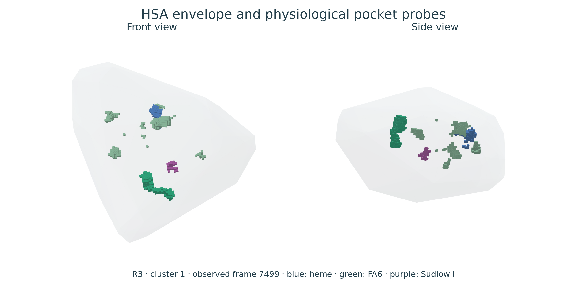
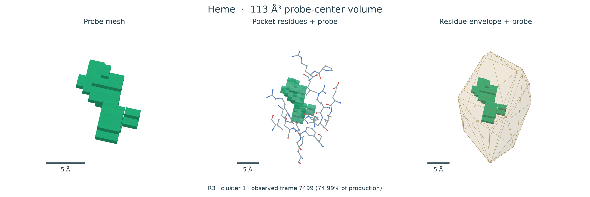
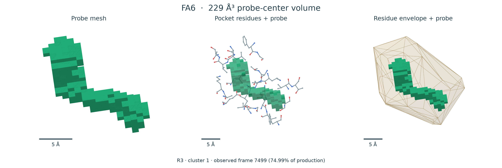
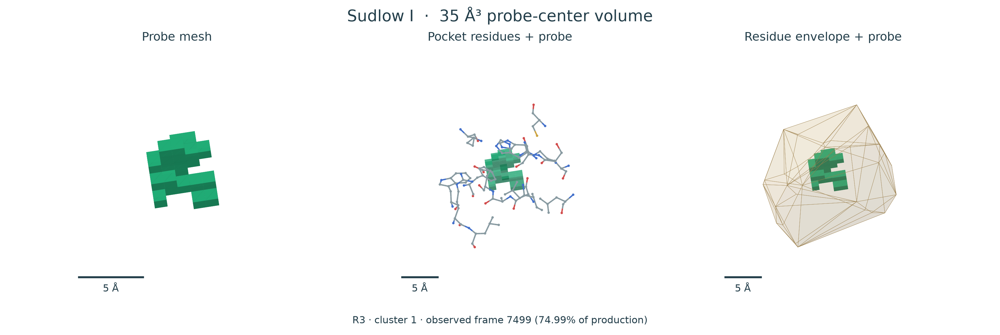

# Native HSA physiological pockets

Tables and structures from the new **585-residue native HSA** series: three independent 1 µs trajectories (R1–R3). Six observed cluster representatives provide eleven physiological regions each.

## Files

```text
tables/       Volumes, frame information and geometry-format index
structures/   R1, R2 and R3, each with cluster_1 and cluster_2
images/       A few previews of the supplied geometric models
```

Start with [pocket_models.csv](tables/pocket_models.csv) to find the frame, residues, volume and directory for each model. [protein_representatives.csv](tables/protein_representatives.csv) identifies all six protein structures.

| Table | Contents |
|---|---|
| [Volume summary](tables/pocket_volume_summary.csv) | Mean and sample SD of the three replica means |
| [Per-replica volumes](tables/per_replica_pocket_volumes.csv) | Mean, median and spread within each replica |
| [Sampled volumes](tables/sampled_pocket_volumes.csv) | The 102 sampled frames per replica and region |
| [Pocket models](tables/pocket_models.csv) | The 66 extracted region models, lining residues and source frames |
| [Protein representatives](tables/protein_representatives.csv) | Cluster populations and representative-frame selection |
| [Geometry formats](tables/geometry_formats.csv) | Dummy-vertex MOL/SDF/MOL2 models and their source meshes |

## Structure files

Each `structures/R#/cluster_#/` directory contains the protein and its eleven physiological regions, including the cleft and heme region. All models in one directory come from the **same observed MD frame**.

| File | Model |
|---|---|
| `protein.pdb` | Complete protein |
| `protein_hull.pdb`, `.obj`, `.ply` | Convex envelope of the complete protein |
| `HSA_with_all_pockets.pdb` | Atomic protein with all physiological probe points |
| `HSA_hull_with_all_pockets.pdb`, `.obj` | Protein envelope with all pocket probes |
| `SITE/pocket_atoms.pdb` | Extracted pocket-lining atoms |
| `SITE/probe.pdb`, `.obj`, `.ply` | Probe-center cavity geometry |
| `SITE/lining_hull.pdb`, `.obj`, `.ply` | Convex envelope of the lining atoms |
| `SITE/pocket_with_geometry.pdb` | Pocket atoms and their geometric model |
| `SITE/protein_with_pocket.pdb` | Complete protein with that pocket geometry |

Coordinates and mesh dimensions are in Å. PDB files can be opened in molecular viewers; OBJ and PLY contain surface meshes.

## Model previews

The images below render the actual OBJ vertices and faces from **R3, cluster 1, frame 7499 (74.99% of production)**. Green shows the probe mesh. The middle panel adds the actual pocket-lining atoms, with bonds taken from the native Amber topology; the right panel adds their pale amber convex envelope. Probe-only panels share one scale, and residue-envelope panels share another. The scale bars have a length of 5 Å.



| Preview | Corresponding structure |
|---|---|
| Whole HSA and all physiological regions | [PDB](structures/R3/cluster_1/HSA_hull_with_all_pockets.pdb) · [OBJ](structures/R3/cluster_1/HSA_hull_with_all_pockets.obj) |

### Heme



[Probe PDB](structures/R3/cluster_1/Heme/probe.pdb) · [Probe OBJ](structures/R3/cluster_1/Heme/probe.obj) · [Pocket atoms and geometry](structures/R3/cluster_1/Heme/pocket_with_geometry.pdb)

### FA6



[Probe PDB](structures/R3/cluster_1/FA6/probe.pdb) · [Probe OBJ](structures/R3/cluster_1/FA6/probe.obj) · [Pocket atoms and geometry](structures/R3/cluster_1/FA6/pocket_with_geometry.pdb)

### Sudlow I



[Probe PDB](structures/R3/cluster_1/Sudlow_I/probe.pdb) · [Probe OBJ](structures/R3/cluster_1/Sudlow_I/probe.obj) · [Pocket atoms and geometry](structures/R3/cluster_1/Sudlow_I/pocket_with_geometry.pdb)

## Additional geometric formats

Every OBJ model also has matching `.sdf`, `.mol` and `.mol2` files, including
individual probes, residue hulls and the whole-protein envelope with all pockets.
[geometry_formats.csv](tables/geometry_formats.csv) lists their paths and the
numbers of vertices, edges and faces.

These exports encode **geometric vertices as dummy atoms** (`*` in MOL/SDF,
`Du` in MOL2). Their links are mesh edges. They carry no chemical atom types,
physical charges or force-field parameters. MOL and SDF use V3000. OBJ and PLY
retain surface faces directly; SDF also records the original face indices as
a data field. MOL2 stores those indices in comments. Empty source models remain
empty and are identified in the table.

For example: heme [SDF](structures/R3/cluster_1/Heme/probe.sdf) ·
[MOL](structures/R3/cluster_1/Heme/probe.mol) ·
[MOL2](structures/R3/cluster_1/Heme/probe.mol2).
The coordinate and graph round trips were checked using
[RDKit](https://www.rdkit.org/docs/source/rdkit.Chem.rdmolfiles.html);
[MOL2](https://openbabel.org/docs/FileFormats/Sybyl_Mol2_format.html) readers
must support dummy atom type `Du`.

## Representative frames

| Replica | Cluster | Population | Frame | Production (%) | Protein |
|---|---:|---:|---:|---:|---|
| R1 | 1 | 69.77% | 4532 | 45.32 | [PDB](structures/R1/cluster_1/protein.pdb) |
| R2 | 1 | 37.92% | 4648 | 46.48 | [PDB](structures/R2/cluster_1/protein.pdb) |
| R3 | 1 | 97.17% | 7499 | 74.99 | [PDB](structures/R3/cluster_1/protein.pdb) |
| R1 | 2 | 30.23% | 7432 | 74.32 | [PDB](structures/R1/cluster_2/protein.pdb) |
| R2 | 2 | 62.08% | 9134 | 91.34 | [PDB](structures/R2/cluster_2/protein.pdb) |
| R3 | 2 | 2.83% | 857 | 8.57 | [PDB](structures/R3/cluster_2/protein.pdb) |

## Extraction

Representatives are actual cluster members closest to the mean feature vector of their cluster; they are not averaged coordinates. Local Cα anchors place the ligand-informed physiological regions on each frame. A spherical 1.4 Å probe and a 1 Å grid measure connected free space inside each defined region. The cleft uses the free space within its residue-landmark envelope. The protein and lining hulls are atomic envelopes; the green probe mesh represents accessible probe-center space.

FA7 overlaps Sudlow I; FA3 and FA4 overlap Sudlow II. Region volumes should not be summed. A zero-volume probe has no selected voxels under these definitions; the corresponding lining-atom structures remain available when present.

Source: `CATIONIZED_HSA/series_585_apbs`, native system 0%, collected on 21 October 2026. The original analysis archive and full outputs remain preserved separately.
