# Model gallery

[Back to README](../README.md).

## Choose a template

The **whole-protein representatives** were selected by clustering the three
HSA trajectories using standardized Domain I-III distance, the I-II-III
opening angle and the fraction of native I-III contacts. Ward, k-means and
DBSCAN were compared on 600 uniformly sampled frames, 200 per replica.
Candidates were ranked by the fraction of assigned frames multiplied by
the silhouette score.

| Method | Groups | Assigned training frames | Silhouette | Coverage × silhouette |
|---|---:|---:|---:|---:|
| Ward | 2 | 100.0% | 0.382 | 0.382 |
| K-means | 2 | 100.0% | 0.366 | 0.366 |
| DBSCAN | 3 | 68.2% | 0.293 | 0.200 |

Ward gave the highest score and identified two groups. All 30,000 saved frames
were assigned to their nearest group center. The observed frame closest to
each center was retained, and all eleven pocket geometries were calculated
on that frame. DBSCAN left 31.8% of the training frames and 33.0% of the full
dataset unassigned.

The **pocket-shape representatives** were selected separately for each pocket
from 306 frames, sampled equally across the three simulations. Locally aligned
cavity shapes were grouped by spatial overlap. DBSCAN identified two nonempty
groups for FA5; the other pockets were each represented by one nonempty group.
Within the largest group, the frame with the smallest average shape difference
from the other members was retained.

The **mean-volume representatives** were selected separately for each pocket
as the observed frame whose cavity volume was closest to the mean over the
same 306 sampled frames.

[Detailed methods and clustering comparisons](../tables/README.md).

### Whole-protein representative

The dominant conformation represents the largest protein cluster, containing
68.3% of the frames. The alternative represents the second cluster, containing
31.7%. All eleven pockets in each collection were calculated on its selected
protein frame.

The dominant model is in
[`whole_protein/`](../structures/representative/whole_protein), and the alternative
is in [`whole_protein_group_2/`](../structures/representative/whole_protein_group_2).

<picture>
  <source media="(prefers-color-scheme: dark)" srcset="../images/whole_protein_overview_dark.svg">
  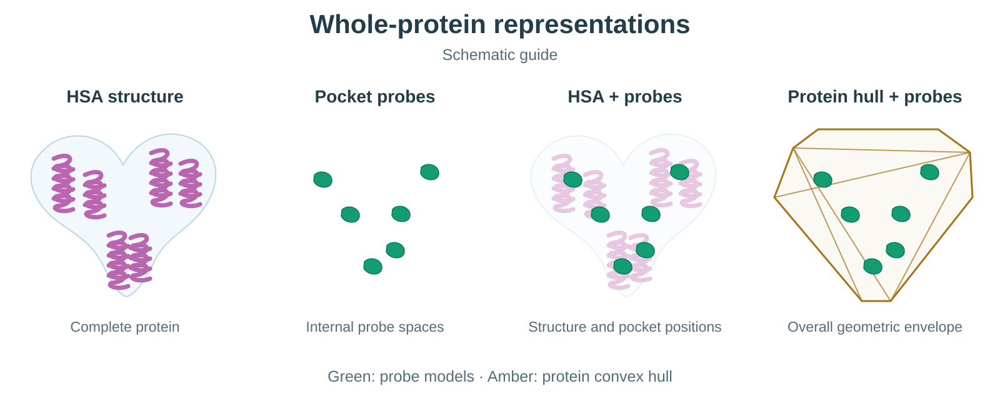
</picture>

Whole HSA - view all representations

<picture>
  <source media="(prefers-color-scheme: dark)" srcset="../images/HSA_common_representative_dark.png">
  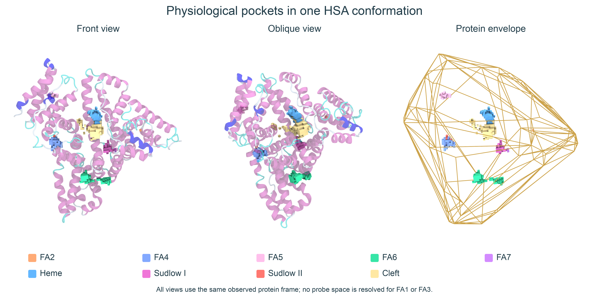
</picture>

The structures are aligned on Domain II and shown at the same scale. The
cartoon shows secondary structure; colored probes mark the calculated cavity
spaces. The wireframe is the convex envelope of the complete protein.

| Contents | Dominant conformation, 68.3% | Alternative conformation, 31.7% |
|---|---|---|
| Protein atoms | [PDB](../structures/representative/whole_protein/protein.pdb) | [PDB](../structures/representative/whole_protein_group_2/protein.pdb) |
| Protein atoms and all pocket probes | [PDB](../structures/representative/whole_protein/protein_with_probes.pdb) | [PDB](../structures/representative/whole_protein_group_2/protein_with_probes.pdb) |
| Protein atoms, all probes and protein hull | [PDB](../structures/representative/whole_protein/protein_with_probes_and_hull.pdb) | [PDB](../structures/representative/whole_protein_group_2/protein_with_probes_and_hull.pdb) |
| Protein hull and all probes | [PDB](../structures/representative/whole_protein/probes_protein_hull.pdb), [OBJ](../structures/representative/whole_protein/probes_protein_hull.obj), [SDF](../structures/representative/whole_protein/probes_protein_hull.sdf) | [PDB](../structures/representative/whole_protein_group_2/probes_protein_hull.pdb), [OBJ](../structures/representative/whole_protein_group_2/probes_protein_hull.obj), [SDF](../structures/representative/whole_protein_group_2/probes_protein_hull.sdf) |
| All model files | [Folder](../structures/representative/whole_protein) | [Folder](../structures/representative/whole_protein_group_2) |

#### Dominant conformation - group 1

<picture>
  <source media="(prefers-color-scheme: dark)" srcset="../images/HSA_group_1_representations_dark.png">
  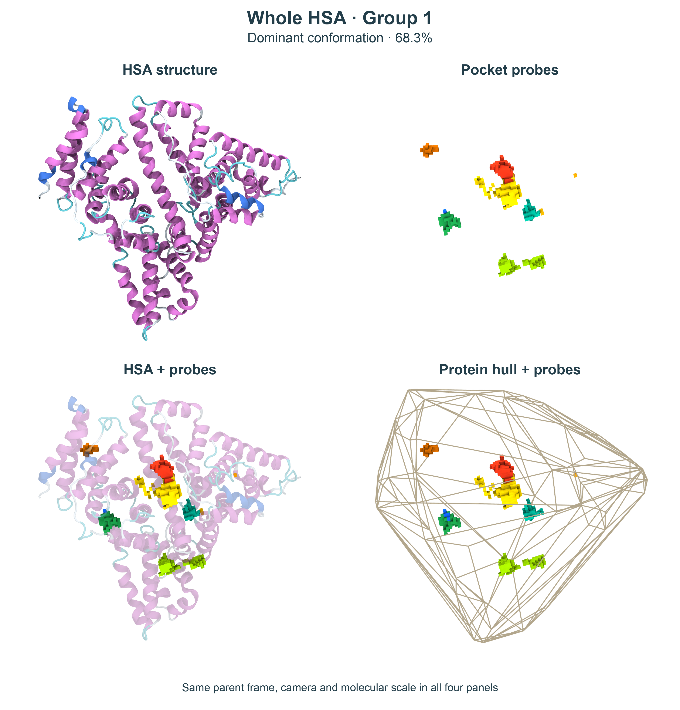
</picture>

#### Alternative conformation - group 2

<picture>
  <source media="(prefers-color-scheme: dark)" srcset="../images/HSA_group_2_representations_dark.png">
  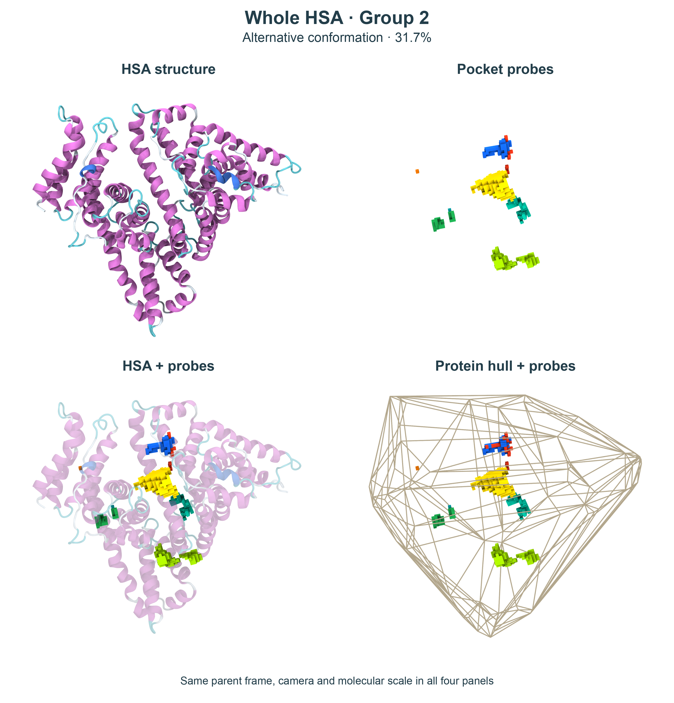
</picture>

#### Protein solid with empty pockets

The full solid is the complete protein convex envelope minus the union of
the eleven probe spaces. Overlapping spaces are subtracted once.

The local solid contains one empty cavity and its surrounding material.
Its outer boundary is obtained by extending the convex envelope of the probe
by 10 Å and clipping it to the parent protein hull. These models are provided
as `pocket_solid.*` for every pocket and representative type.

<picture>
  <source media="(prefers-color-scheme: dark)" srcset="../images/protein_solid_group_1_dark.png">
  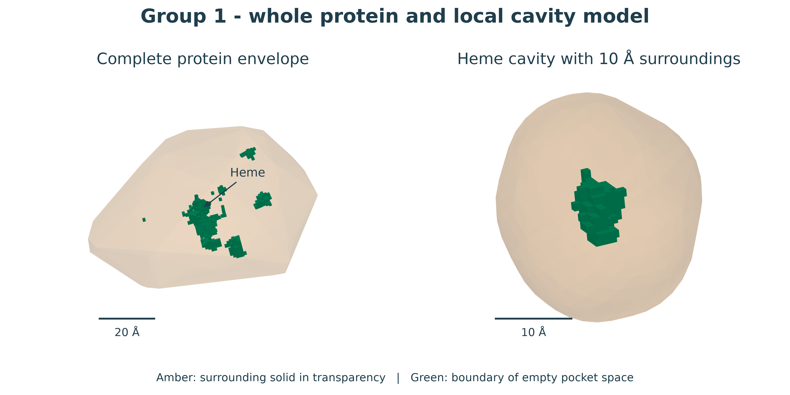
</picture>

<picture>
  <source media="(prefers-color-scheme: dark)" srcset="../images/protein_solid_group_2_dark.png">
  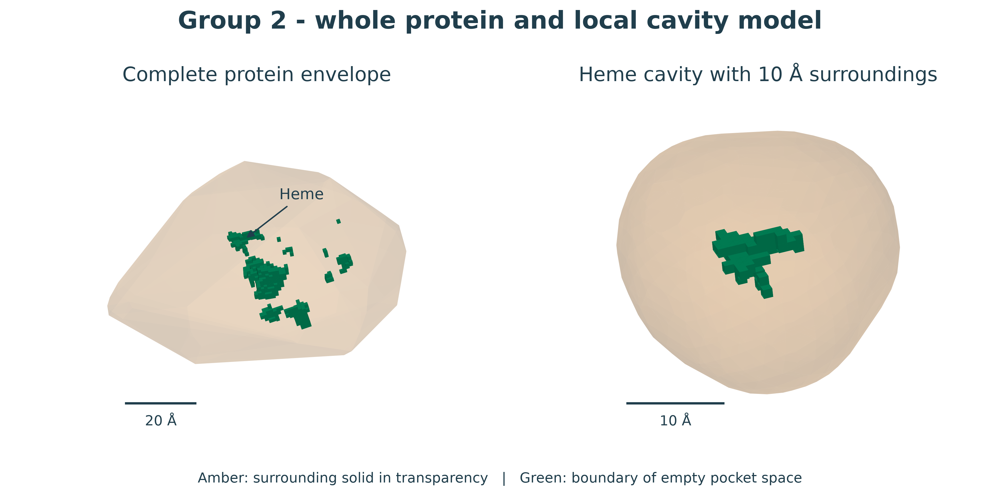
</picture>

Amber marks the surrounding solid; green marks the boundary of the empty
cavity.

| Contents | Dominant conformation | Alternative conformation |
|---|---|---|
| Protein solid with all pocket spaces removed | [OBJ](../structures/representative/whole_protein/protein_solid.obj), [PDB](../structures/representative/whole_protein/protein_solid.pdb), [SDF](../structures/representative/whole_protein/protein_solid.sdf) | [OBJ](../structures/representative/whole_protein_group_2/protein_solid.obj), [PDB](../structures/representative/whole_protein_group_2/protein_solid.pdb), [SDF](../structures/representative/whole_protein_group_2/protein_solid.sdf) |
| Combined empty pocket spaces | [OBJ](../structures/representative/whole_protein/pocket_voids.obj), [PDB](../structures/representative/whole_protein/pocket_voids.pdb), [SDF](../structures/representative/whole_protein/pocket_voids.sdf) | [OBJ](../structures/representative/whole_protein_group_2/pocket_voids.obj), [PDB](../structures/representative/whole_protein_group_2/pocket_voids.pdb), [SDF](../structures/representative/whole_protein_group_2/pocket_voids.sdf) |

Model volumes are reported in
[solid_models.csv](../tables/solid_models.csv) and
[pocket_solid_models.csv](../tables/pocket_solid_models.csv).

### Pocket-shape representatives

Each pocket-shape model contains the cavity selected by local shape clustering,
its lining residues and its complete source protein. Different pockets can
therefore come from different frames. These models are in
[`pocket_geometry/`](../structures/representative/pocket_geometry).

Green marks probe space; the amber wireframe encloses the lining residues.

<picture>
  <source media="(prefers-color-scheme: dark)" srcset="../images/representations_overview_dark.svg">
  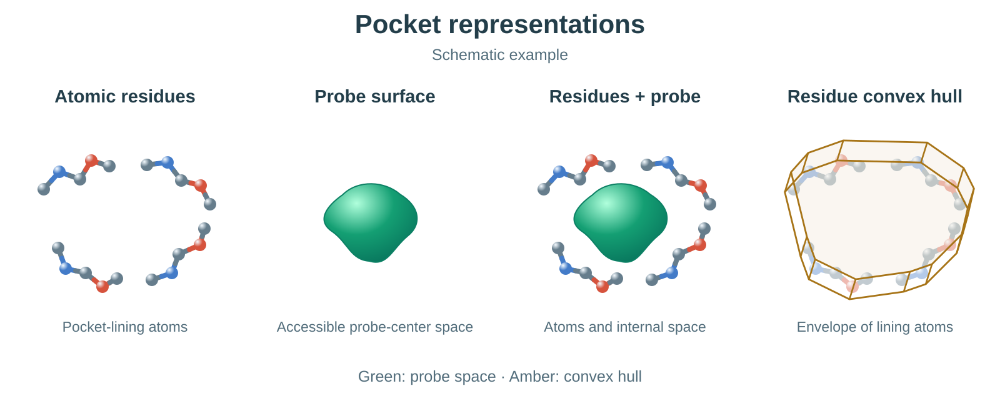
</picture>

Residue and probe views compare the dominant protein, pocket-shape and
mean-volume frames. Solid models also include the alternative protein frame.
The models share a local Cα alignment and scale within each pocket.

Sudlow I - view all representations

#### Sudlow I

<picture>
  <source media="(prefers-color-scheme: dark)" srcset="../images/Sudlow_I_representatives_dark.png">
  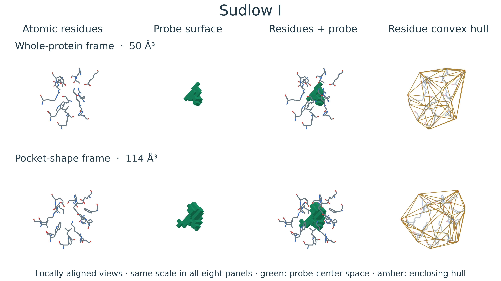
</picture>

<picture>
  <source media="(prefers-color-scheme: dark)" srcset="../images/Sudlow_I_pocket_solid_dark.png">
  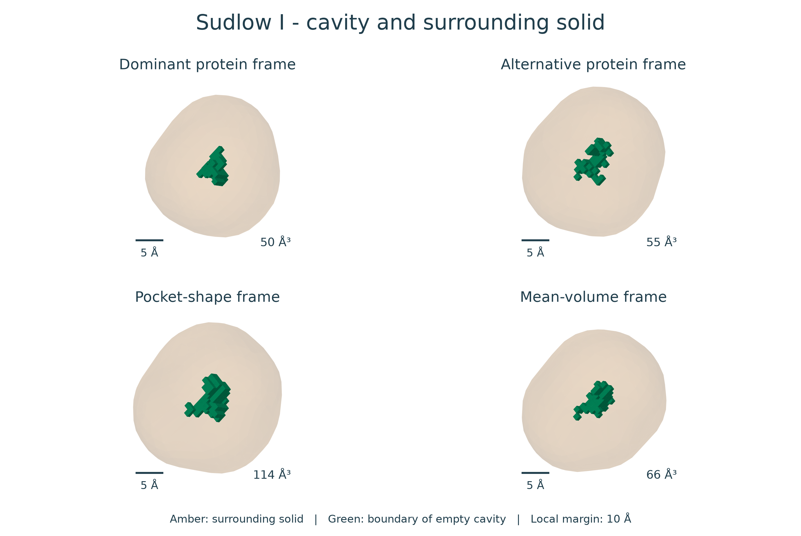
</picture>

| Frame selection | Atomic lining residues | Cavity with surrounding solid | All pocket models |
|---|---|---|---|
| Dominant protein frame | [PDB](../structures/representative/whole_protein/Sudlow_I/residues.pdb) | [OBJ](../structures/representative/whole_protein/Sudlow_I/pocket_solid.obj), [PDB](../structures/representative/whole_protein/Sudlow_I/pocket_solid.pdb), [SDF](../structures/representative/whole_protein/Sudlow_I/pocket_solid.sdf) | [Folder](../structures/representative/whole_protein/Sudlow_I) |
| Alternative protein frame | [PDB](../structures/representative/whole_protein_group_2/Sudlow_I/residues.pdb) | [OBJ](../structures/representative/whole_protein_group_2/Sudlow_I/pocket_solid.obj), [PDB](../structures/representative/whole_protein_group_2/Sudlow_I/pocket_solid.pdb), [SDF](../structures/representative/whole_protein_group_2/Sudlow_I/pocket_solid.sdf) | [Folder](../structures/representative/whole_protein_group_2/Sudlow_I) |
| Pocket-shape frame | [PDB](../structures/representative/pocket_geometry/Sudlow_I/residues.pdb) | [OBJ](../structures/representative/pocket_geometry/Sudlow_I/pocket_solid.obj), [PDB](../structures/representative/pocket_geometry/Sudlow_I/pocket_solid.pdb), [SDF](../structures/representative/pocket_geometry/Sudlow_I/pocket_solid.sdf) | [Folder](../structures/representative/pocket_geometry/Sudlow_I) |
| Mean-volume frame | [PDB](../structures/representative/mean_volume/Sudlow_I/residues.pdb) | [OBJ](../structures/representative/mean_volume/Sudlow_I/pocket_solid.obj), [PDB](../structures/representative/mean_volume/Sudlow_I/pocket_solid.pdb), [SDF](../structures/representative/mean_volume/Sudlow_I/pocket_solid.sdf) | [Folder](../structures/representative/mean_volume/Sudlow_I) |

Sudlow II - view all representations

#### Sudlow II

<picture>
  <source media="(prefers-color-scheme: dark)" srcset="../images/Sudlow_II_representatives_dark.png">
  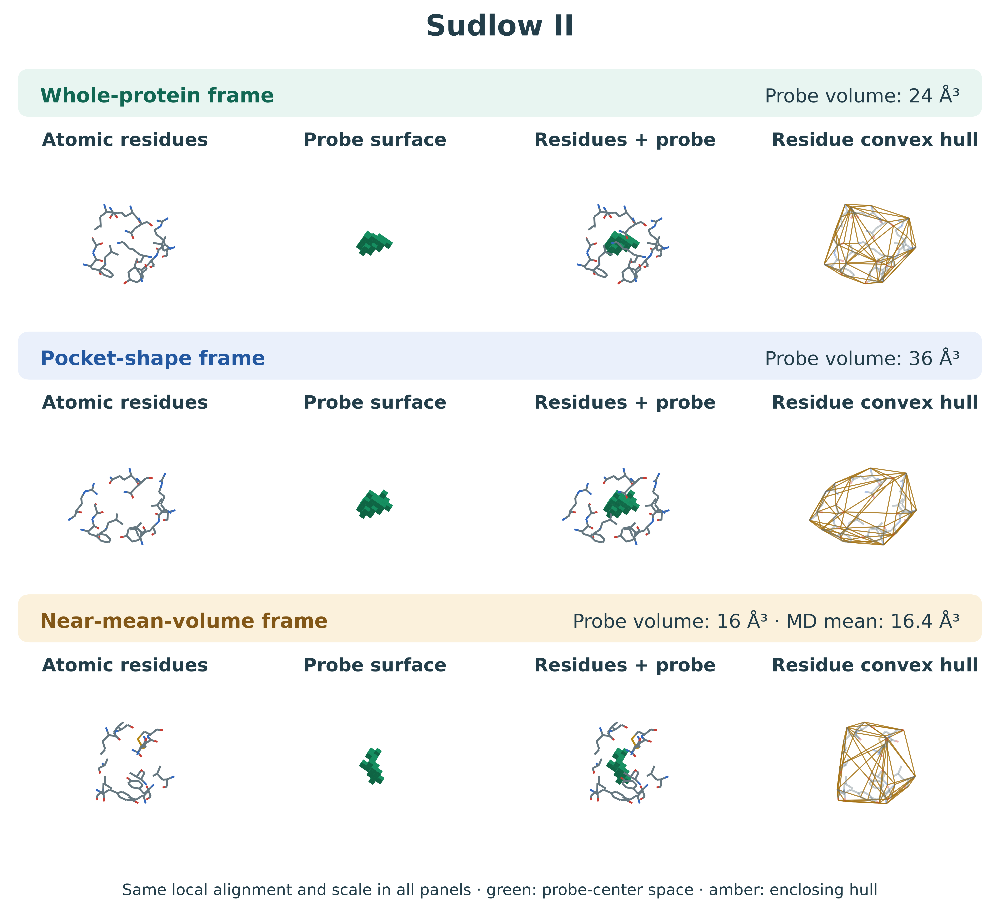
</picture>

<picture>
  <source media="(prefers-color-scheme: dark)" srcset="../images/Sudlow_II_pocket_solid_dark.png">
  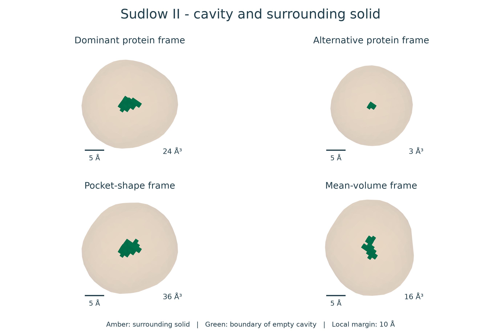
</picture>

| Frame selection | Atomic lining residues | Cavity with surrounding solid | All pocket models |
|---|---|---|---|
| Dominant protein frame | [PDB](../structures/representative/whole_protein/Sudlow_II/residues.pdb) | [OBJ](../structures/representative/whole_protein/Sudlow_II/pocket_solid.obj), [PDB](../structures/representative/whole_protein/Sudlow_II/pocket_solid.pdb), [SDF](../structures/representative/whole_protein/Sudlow_II/pocket_solid.sdf) | [Folder](../structures/representative/whole_protein/Sudlow_II) |
| Alternative protein frame | [PDB](../structures/representative/whole_protein_group_2/Sudlow_II/residues.pdb) | [OBJ](../structures/representative/whole_protein_group_2/Sudlow_II/pocket_solid.obj), [PDB](../structures/representative/whole_protein_group_2/Sudlow_II/pocket_solid.pdb), [SDF](../structures/representative/whole_protein_group_2/Sudlow_II/pocket_solid.sdf) | [Folder](../structures/representative/whole_protein_group_2/Sudlow_II) |
| Pocket-shape frame | [PDB](../structures/representative/pocket_geometry/Sudlow_II/residues.pdb) | [OBJ](../structures/representative/pocket_geometry/Sudlow_II/pocket_solid.obj), [PDB](../structures/representative/pocket_geometry/Sudlow_II/pocket_solid.pdb), [SDF](../structures/representative/pocket_geometry/Sudlow_II/pocket_solid.sdf) | [Folder](../structures/representative/pocket_geometry/Sudlow_II) |
| Mean-volume frame | [PDB](../structures/representative/mean_volume/Sudlow_II/residues.pdb) | [OBJ](../structures/representative/mean_volume/Sudlow_II/pocket_solid.obj), [PDB](../structures/representative/mean_volume/Sudlow_II/pocket_solid.pdb), [SDF](../structures/representative/mean_volume/Sudlow_II/pocket_solid.sdf) | [Folder](../structures/representative/mean_volume/Sudlow_II) |

Heme - view all representations

#### Heme

<picture>
  <source media="(prefers-color-scheme: dark)" srcset="../images/Heme_representatives_dark.png">
  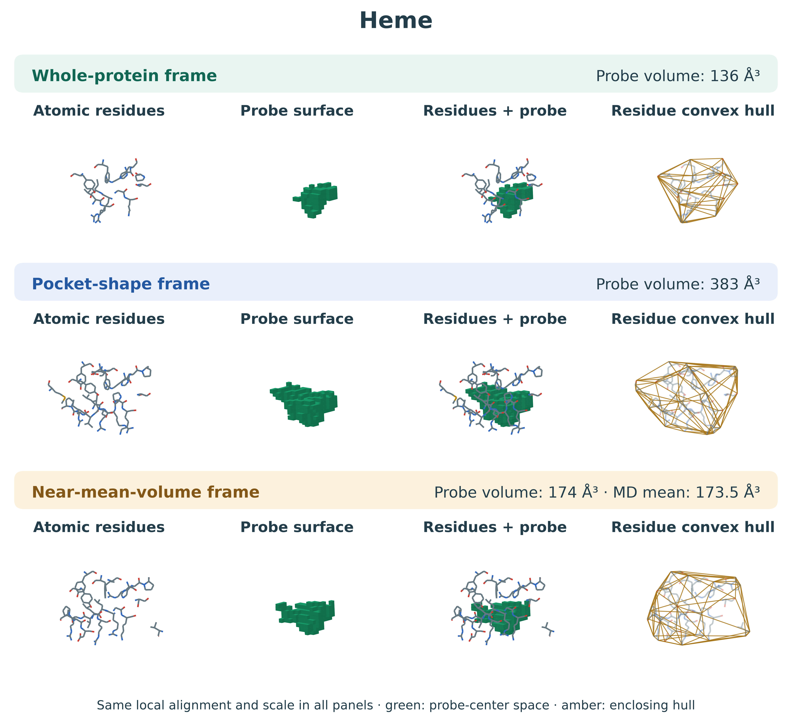
</picture>

<picture>
  <source media="(prefers-color-scheme: dark)" srcset="../images/Heme_pocket_solid_dark.png">
  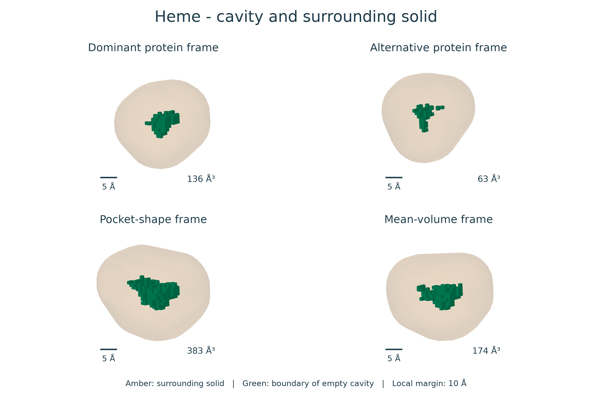
</picture>

| Frame selection | Atomic lining residues | Cavity with surrounding solid | All pocket models |
|---|---|---|---|
| Dominant protein frame | [PDB](../structures/representative/whole_protein/Heme/residues.pdb) | [OBJ](../structures/representative/whole_protein/Heme/pocket_solid.obj), [PDB](../structures/representative/whole_protein/Heme/pocket_solid.pdb), [SDF](../structures/representative/whole_protein/Heme/pocket_solid.sdf) | [Folder](../structures/representative/whole_protein/Heme) |
| Alternative protein frame | [PDB](../structures/representative/whole_protein_group_2/Heme/residues.pdb) | [OBJ](../structures/representative/whole_protein_group_2/Heme/pocket_solid.obj), [PDB](../structures/representative/whole_protein_group_2/Heme/pocket_solid.pdb), [SDF](../structures/representative/whole_protein_group_2/Heme/pocket_solid.sdf) | [Folder](../structures/representative/whole_protein_group_2/Heme) |
| Pocket-shape frame | [PDB](../structures/representative/pocket_geometry/Heme/residues.pdb) | [OBJ](../structures/representative/pocket_geometry/Heme/pocket_solid.obj), [PDB](../structures/representative/pocket_geometry/Heme/pocket_solid.pdb), [SDF](../structures/representative/pocket_geometry/Heme/pocket_solid.sdf) | [Folder](../structures/representative/pocket_geometry/Heme) |
| Mean-volume frame | [PDB](../structures/representative/mean_volume/Heme/residues.pdb) | [OBJ](../structures/representative/mean_volume/Heme/pocket_solid.obj), [PDB](../structures/representative/mean_volume/Heme/pocket_solid.pdb), [SDF](../structures/representative/mean_volume/Heme/pocket_solid.sdf) | [Folder](../structures/representative/mean_volume/Heme) |

Cleft - view all representations

#### Cleft

<picture>
  <source media="(prefers-color-scheme: dark)" srcset="../images/Cleft_representatives_dark.png">
  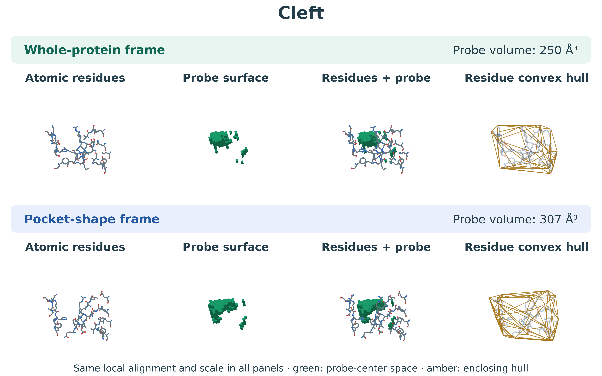
</picture>

<picture>
  <source media="(prefers-color-scheme: dark)" srcset="../images/Cleft_pocket_solid_dark.png">
  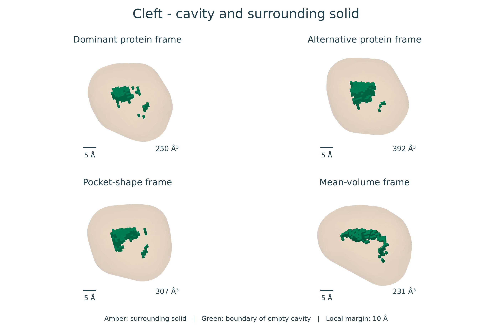
</picture>

| Frame selection | Atomic lining residues | Cavity with surrounding solid | All pocket models |
|---|---|---|---|
| Dominant protein frame | [PDB](../structures/representative/whole_protein/Cleft/residues.pdb) | [OBJ](../structures/representative/whole_protein/Cleft/pocket_solid.obj), [PDB](../structures/representative/whole_protein/Cleft/pocket_solid.pdb), [SDF](../structures/representative/whole_protein/Cleft/pocket_solid.sdf) | [Folder](../structures/representative/whole_protein/Cleft) |
| Alternative protein frame | [PDB](../structures/representative/whole_protein_group_2/Cleft/residues.pdb) | [OBJ](../structures/representative/whole_protein_group_2/Cleft/pocket_solid.obj), [PDB](../structures/representative/whole_protein_group_2/Cleft/pocket_solid.pdb), [SDF](../structures/representative/whole_protein_group_2/Cleft/pocket_solid.sdf) | [Folder](../structures/representative/whole_protein_group_2/Cleft) |
| Pocket-shape frame | [PDB](../structures/representative/pocket_geometry/Cleft/residues.pdb) | [OBJ](../structures/representative/pocket_geometry/Cleft/pocket_solid.obj), [PDB](../structures/representative/pocket_geometry/Cleft/pocket_solid.pdb), [SDF](../structures/representative/pocket_geometry/Cleft/pocket_solid.sdf) | [Folder](../structures/representative/pocket_geometry/Cleft) |
| Mean-volume frame | [PDB](../structures/representative/mean_volume/Cleft/residues.pdb) | [OBJ](../structures/representative/mean_volume/Cleft/pocket_solid.obj), [PDB](../structures/representative/mean_volume/Cleft/pocket_solid.pdb), [SDF](../structures/representative/mean_volume/Cleft/pocket_solid.sdf) | [Folder](../structures/representative/mean_volume/Cleft) |

FA1 - view all representations

#### FA1

<picture>
  <source media="(prefers-color-scheme: dark)" srcset="../images/FA1_representatives_dark.png">
  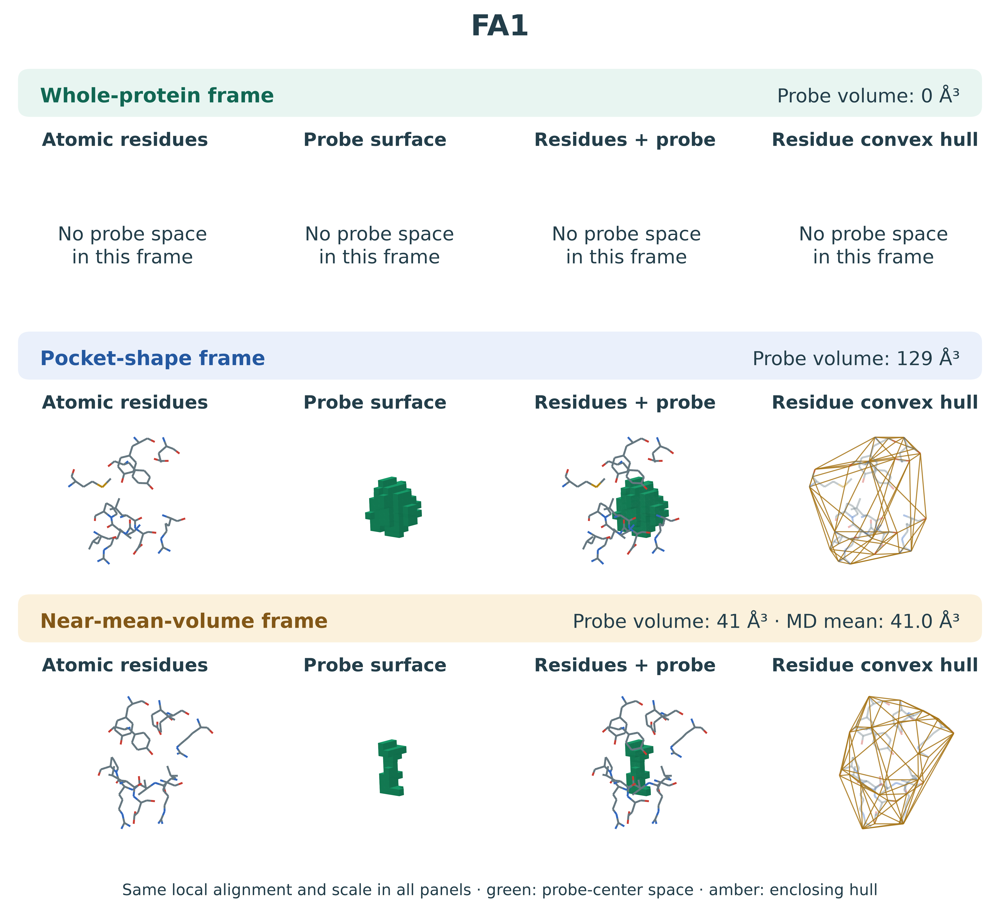
</picture>

<picture>
  <source media="(prefers-color-scheme: dark)" srcset="../images/FA1_pocket_solid_dark.png">
  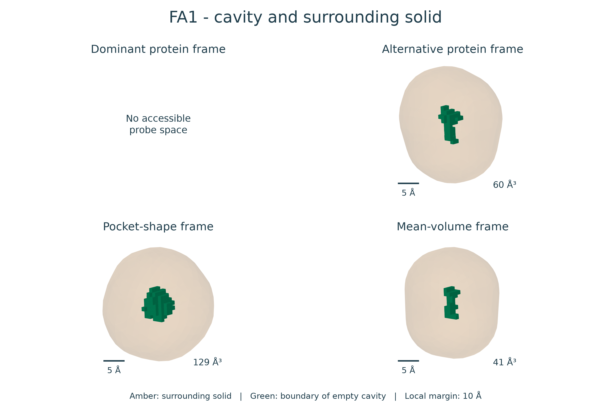
</picture>

| Frame selection | Atomic lining residues | Cavity with surrounding solid | All pocket models |
|---|---|---|---|
| Dominant protein frame | [PDB](../structures/representative/whole_protein/FA1/residues.pdb) | [OBJ](../structures/representative/whole_protein/FA1/pocket_solid.obj), [PDB](../structures/representative/whole_protein/FA1/pocket_solid.pdb), [SDF](../structures/representative/whole_protein/FA1/pocket_solid.sdf) | [Folder](../structures/representative/whole_protein/FA1) |
| Alternative protein frame | [PDB](../structures/representative/whole_protein_group_2/FA1/residues.pdb) | [OBJ](../structures/representative/whole_protein_group_2/FA1/pocket_solid.obj), [PDB](../structures/representative/whole_protein_group_2/FA1/pocket_solid.pdb), [SDF](../structures/representative/whole_protein_group_2/FA1/pocket_solid.sdf) | [Folder](../structures/representative/whole_protein_group_2/FA1) |
| Pocket-shape frame | [PDB](../structures/representative/pocket_geometry/FA1/residues.pdb) | [OBJ](../structures/representative/pocket_geometry/FA1/pocket_solid.obj), [PDB](../structures/representative/pocket_geometry/FA1/pocket_solid.pdb), [SDF](../structures/representative/pocket_geometry/FA1/pocket_solid.sdf) | [Folder](../structures/representative/pocket_geometry/FA1) |
| Mean-volume frame | [PDB](../structures/representative/mean_volume/FA1/residues.pdb) | [OBJ](../structures/representative/mean_volume/FA1/pocket_solid.obj), [PDB](../structures/representative/mean_volume/FA1/pocket_solid.pdb), [SDF](../structures/representative/mean_volume/FA1/pocket_solid.sdf) | [Folder](../structures/representative/mean_volume/FA1) |

FA2 - view all representations

#### FA2

<picture>
  <source media="(prefers-color-scheme: dark)" srcset="../images/FA2_representatives_dark.png">
  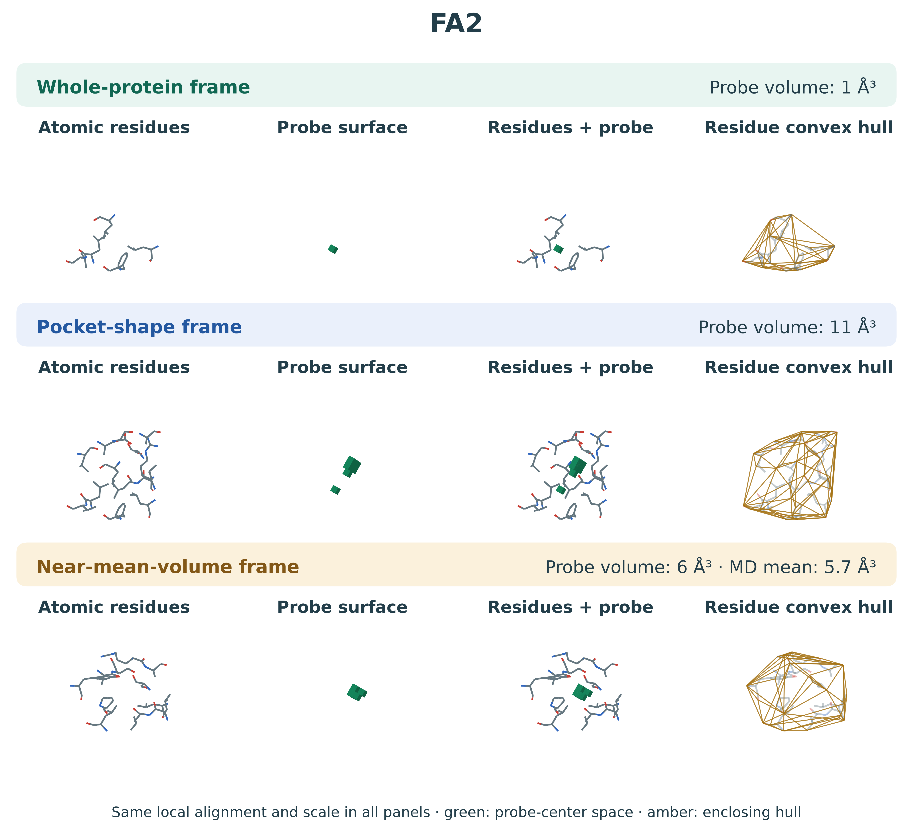
</picture>

<picture>
  <source media="(prefers-color-scheme: dark)" srcset="../images/FA2_pocket_solid_dark.png">
  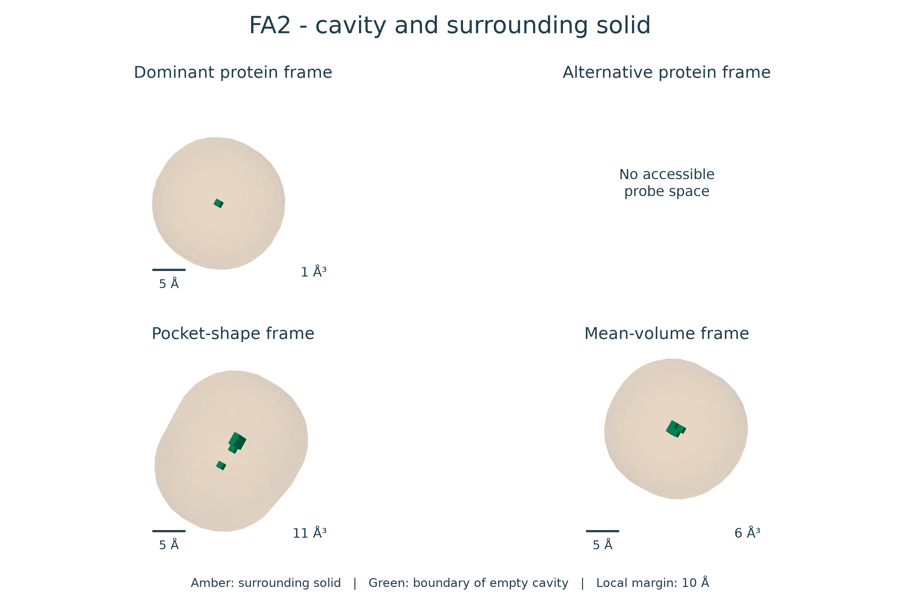
</picture>

| Frame selection | Atomic lining residues | Cavity with surrounding solid | All pocket models |
|---|---|---|---|
| Dominant protein frame | [PDB](../structures/representative/whole_protein/FA2/residues.pdb) | [OBJ](../structures/representative/whole_protein/FA2/pocket_solid.obj), [PDB](../structures/representative/whole_protein/FA2/pocket_solid.pdb), [SDF](../structures/representative/whole_protein/FA2/pocket_solid.sdf) | [Folder](../structures/representative/whole_protein/FA2) |
| Alternative protein frame | [PDB](../structures/representative/whole_protein_group_2/FA2/residues.pdb) | [OBJ](../structures/representative/whole_protein_group_2/FA2/pocket_solid.obj), [PDB](../structures/representative/whole_protein_group_2/FA2/pocket_solid.pdb), [SDF](../structures/representative/whole_protein_group_2/FA2/pocket_solid.sdf) | [Folder](../structures/representative/whole_protein_group_2/FA2) |
| Pocket-shape frame | [PDB](../structures/representative/pocket_geometry/FA2/residues.pdb) | [OBJ](../structures/representative/pocket_geometry/FA2/pocket_solid.obj), [PDB](../structures/representative/pocket_geometry/FA2/pocket_solid.pdb), [SDF](../structures/representative/pocket_geometry/FA2/pocket_solid.sdf) | [Folder](../structures/representative/pocket_geometry/FA2) |
| Mean-volume frame | [PDB](../structures/representative/mean_volume/FA2/residues.pdb) | [OBJ](../structures/representative/mean_volume/FA2/pocket_solid.obj), [PDB](../structures/representative/mean_volume/FA2/pocket_solid.pdb), [SDF](../structures/representative/mean_volume/FA2/pocket_solid.sdf) | [Folder](../structures/representative/mean_volume/FA2) |

FA3 - view all representations

#### FA3

<picture>
  <source media="(prefers-color-scheme: dark)" srcset="../images/FA3_representatives_dark.png">
  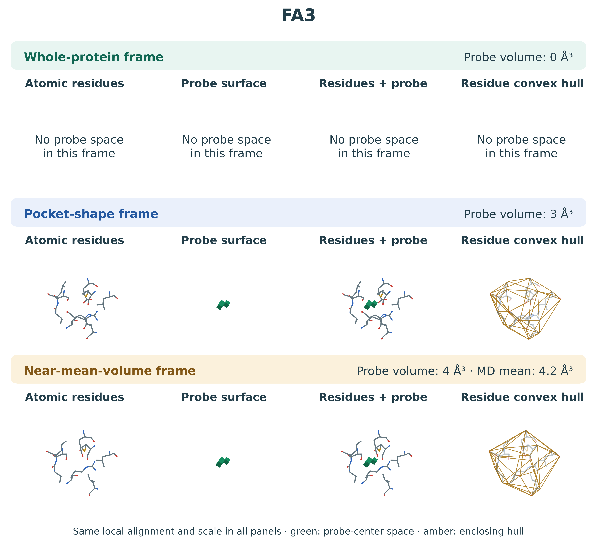
</picture>

<picture>
  <source media="(prefers-color-scheme: dark)" srcset="../images/FA3_pocket_solid_dark.png">
  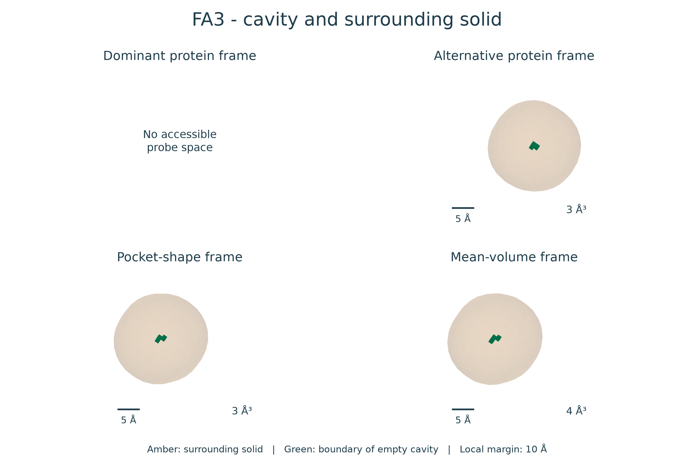
</picture>

| Frame selection | Atomic lining residues | Cavity with surrounding solid | All pocket models |
|---|---|---|---|
| Dominant protein frame | [PDB](../structures/representative/whole_protein/FA3/residues.pdb) | [OBJ](../structures/representative/whole_protein/FA3/pocket_solid.obj), [PDB](../structures/representative/whole_protein/FA3/pocket_solid.pdb), [SDF](../structures/representative/whole_protein/FA3/pocket_solid.sdf) | [Folder](../structures/representative/whole_protein/FA3) |
| Alternative protein frame | [PDB](../structures/representative/whole_protein_group_2/FA3/residues.pdb) | [OBJ](../structures/representative/whole_protein_group_2/FA3/pocket_solid.obj), [PDB](../structures/representative/whole_protein_group_2/FA3/pocket_solid.pdb), [SDF](../structures/representative/whole_protein_group_2/FA3/pocket_solid.sdf) | [Folder](../structures/representative/whole_protein_group_2/FA3) |
| Pocket-shape frame | [PDB](../structures/representative/pocket_geometry/FA3/residues.pdb) | [OBJ](../structures/representative/pocket_geometry/FA3/pocket_solid.obj), [PDB](../structures/representative/pocket_geometry/FA3/pocket_solid.pdb), [SDF](../structures/representative/pocket_geometry/FA3/pocket_solid.sdf) | [Folder](../structures/representative/pocket_geometry/FA3) |
| Mean-volume frame | [PDB](../structures/representative/mean_volume/FA3/residues.pdb) | [OBJ](../structures/representative/mean_volume/FA3/pocket_solid.obj), [PDB](../structures/representative/mean_volume/FA3/pocket_solid.pdb), [SDF](../structures/representative/mean_volume/FA3/pocket_solid.sdf) | [Folder](../structures/representative/mean_volume/FA3) |

FA4 - view all representations

#### FA4

<picture>
  <source media="(prefers-color-scheme: dark)" srcset="../images/FA4_representatives_dark.png">
  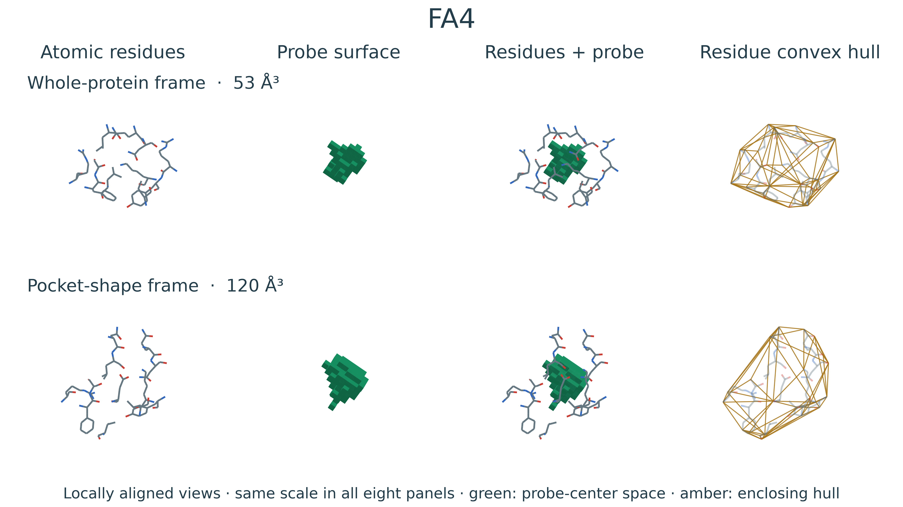
</picture>

<picture>
  <source media="(prefers-color-scheme: dark)" srcset="../images/FA4_pocket_solid_dark.png">
  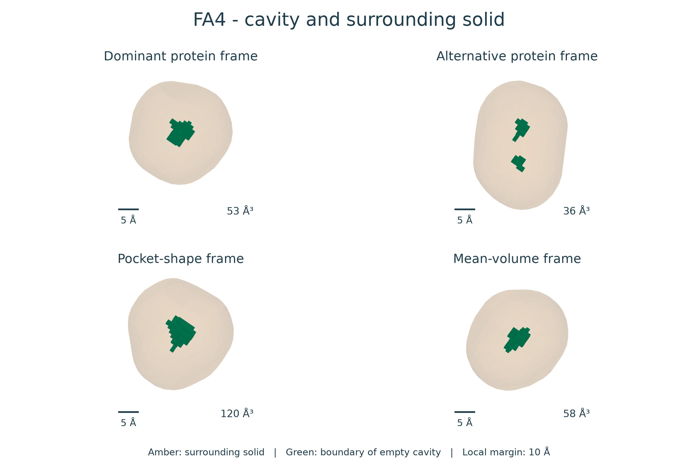
</picture>

| Frame selection | Atomic lining residues | Cavity with surrounding solid | All pocket models |
|---|---|---|---|
| Dominant protein frame | [PDB](../structures/representative/whole_protein/FA4/residues.pdb) | [OBJ](../structures/representative/whole_protein/FA4/pocket_solid.obj), [PDB](../structures/representative/whole_protein/FA4/pocket_solid.pdb), [SDF](../structures/representative/whole_protein/FA4/pocket_solid.sdf) | [Folder](../structures/representative/whole_protein/FA4) |
| Alternative protein frame | [PDB](../structures/representative/whole_protein_group_2/FA4/residues.pdb) | [OBJ](../structures/representative/whole_protein_group_2/FA4/pocket_solid.obj), [PDB](../structures/representative/whole_protein_group_2/FA4/pocket_solid.pdb), [SDF](../structures/representative/whole_protein_group_2/FA4/pocket_solid.sdf) | [Folder](../structures/representative/whole_protein_group_2/FA4) |
| Pocket-shape frame | [PDB](../structures/representative/pocket_geometry/FA4/residues.pdb) | [OBJ](../structures/representative/pocket_geometry/FA4/pocket_solid.obj), [PDB](../structures/representative/pocket_geometry/FA4/pocket_solid.pdb), [SDF](../structures/representative/pocket_geometry/FA4/pocket_solid.sdf) | [Folder](../structures/representative/pocket_geometry/FA4) |
| Mean-volume frame | [PDB](../structures/representative/mean_volume/FA4/residues.pdb) | [OBJ](../structures/representative/mean_volume/FA4/pocket_solid.obj), [PDB](../structures/representative/mean_volume/FA4/pocket_solid.pdb), [SDF](../structures/representative/mean_volume/FA4/pocket_solid.sdf) | [Folder](../structures/representative/mean_volume/FA4) |

FA5 - view all representations

#### FA5

<picture>
  <source media="(prefers-color-scheme: dark)" srcset="../images/FA5_representatives_dark.png">
  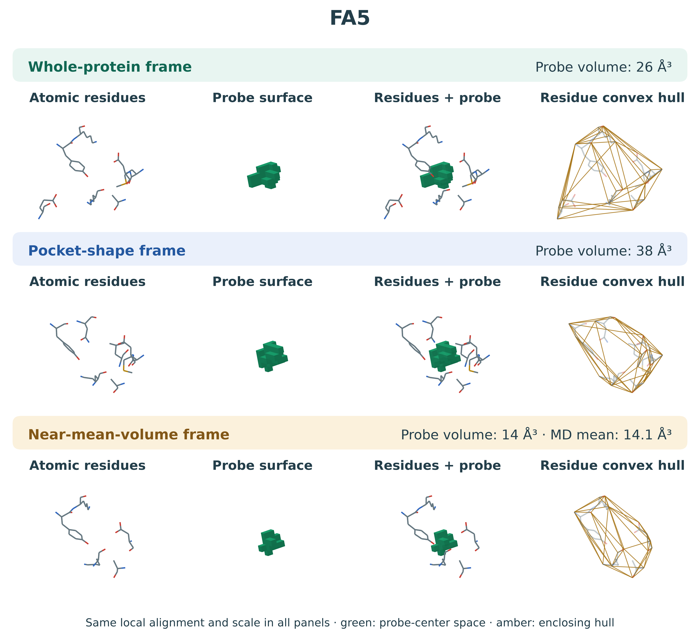
</picture>

<picture>
  <source media="(prefers-color-scheme: dark)" srcset="../images/FA5_pocket_solid_dark.png">
  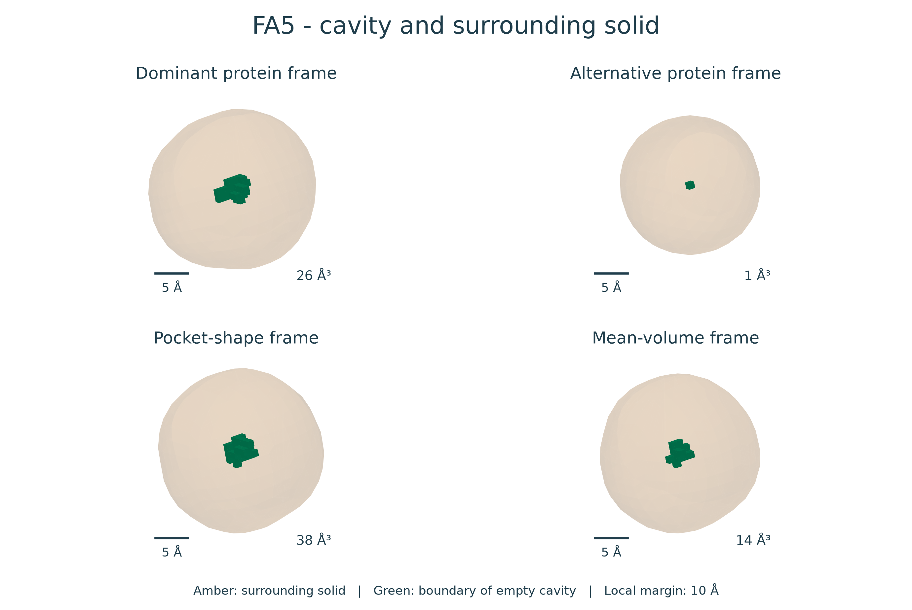
</picture>

| Frame selection | Atomic lining residues | Cavity with surrounding solid | All pocket models |
|---|---|---|---|
| Dominant protein frame | [PDB](../structures/representative/whole_protein/FA5/residues.pdb) | [OBJ](../structures/representative/whole_protein/FA5/pocket_solid.obj), [PDB](../structures/representative/whole_protein/FA5/pocket_solid.pdb), [SDF](../structures/representative/whole_protein/FA5/pocket_solid.sdf) | [Folder](../structures/representative/whole_protein/FA5) |
| Alternative protein frame | [PDB](../structures/representative/whole_protein_group_2/FA5/residues.pdb) | [OBJ](../structures/representative/whole_protein_group_2/FA5/pocket_solid.obj), [PDB](../structures/representative/whole_protein_group_2/FA5/pocket_solid.pdb), [SDF](../structures/representative/whole_protein_group_2/FA5/pocket_solid.sdf) | [Folder](../structures/representative/whole_protein_group_2/FA5) |
| Pocket-shape frame | [PDB](../structures/representative/pocket_geometry/FA5/residues.pdb) | [OBJ](../structures/representative/pocket_geometry/FA5/pocket_solid.obj), [PDB](../structures/representative/pocket_geometry/FA5/pocket_solid.pdb), [SDF](../structures/representative/pocket_geometry/FA5/pocket_solid.sdf) | [Folder](../structures/representative/pocket_geometry/FA5) |
| Mean-volume frame | [PDB](../structures/representative/mean_volume/FA5/residues.pdb) | [OBJ](../structures/representative/mean_volume/FA5/pocket_solid.obj), [PDB](../structures/representative/mean_volume/FA5/pocket_solid.pdb), [SDF](../structures/representative/mean_volume/FA5/pocket_solid.sdf) | [Folder](../structures/representative/mean_volume/FA5) |

FA6 - view all representations

#### FA6

<picture>
  <source media="(prefers-color-scheme: dark)" srcset="../images/FA6_representatives_dark.png">
  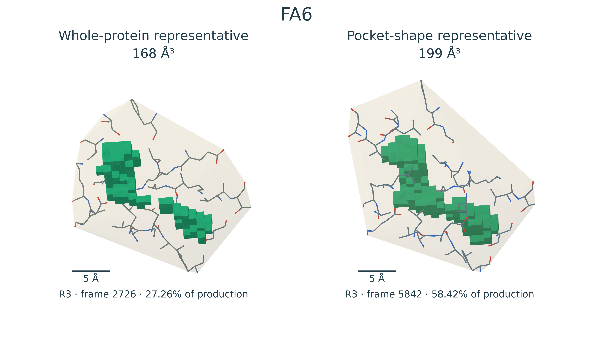
</picture>

<picture>
  <source media="(prefers-color-scheme: dark)" srcset="../images/FA6_pocket_solid_dark.png">
  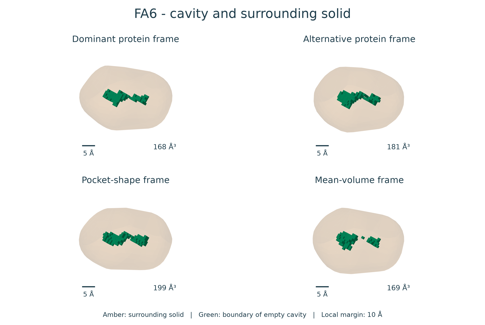
</picture>

| Frame selection | Atomic lining residues | Cavity with surrounding solid | All pocket models |
|---|---|---|---|
| Dominant protein frame | [PDB](../structures/representative/whole_protein/FA6/residues.pdb) | [OBJ](../structures/representative/whole_protein/FA6/pocket_solid.obj), [PDB](../structures/representative/whole_protein/FA6/pocket_solid.pdb), [SDF](../structures/representative/whole_protein/FA6/pocket_solid.sdf) | [Folder](../structures/representative/whole_protein/FA6) |
| Alternative protein frame | [PDB](../structures/representative/whole_protein_group_2/FA6/residues.pdb) | [OBJ](../structures/representative/whole_protein_group_2/FA6/pocket_solid.obj), [PDB](../structures/representative/whole_protein_group_2/FA6/pocket_solid.pdb), [SDF](../structures/representative/whole_protein_group_2/FA6/pocket_solid.sdf) | [Folder](../structures/representative/whole_protein_group_2/FA6) |
| Pocket-shape frame | [PDB](../structures/representative/pocket_geometry/FA6/residues.pdb) | [OBJ](../structures/representative/pocket_geometry/FA6/pocket_solid.obj), [PDB](../structures/representative/pocket_geometry/FA6/pocket_solid.pdb), [SDF](../structures/representative/pocket_geometry/FA6/pocket_solid.sdf) | [Folder](../structures/representative/pocket_geometry/FA6) |
| Mean-volume frame | [PDB](../structures/representative/mean_volume/FA6/residues.pdb) | [OBJ](../structures/representative/mean_volume/FA6/pocket_solid.obj), [PDB](../structures/representative/mean_volume/FA6/pocket_solid.pdb), [SDF](../structures/representative/mean_volume/FA6/pocket_solid.sdf) | [Folder](../structures/representative/mean_volume/FA6) |

FA7 - view all representations

#### FA7

<picture>
  <source media="(prefers-color-scheme: dark)" srcset="../images/FA7_representatives_dark.png">
  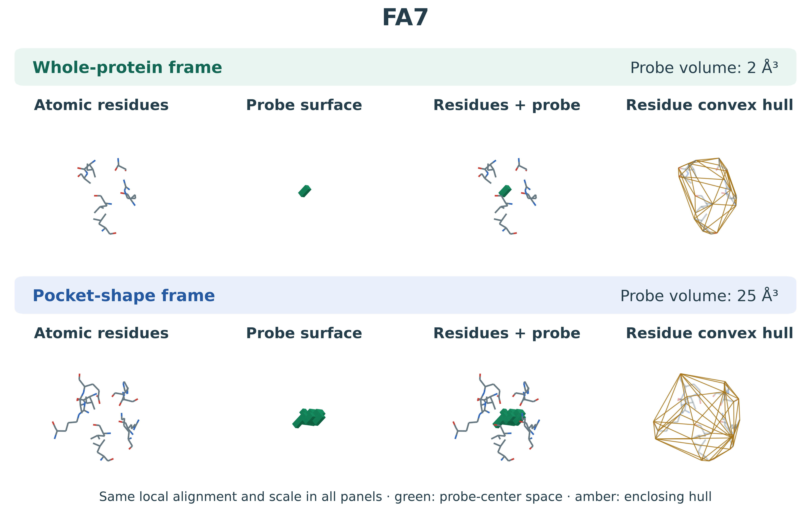
</picture>

<picture>
  <source media="(prefers-color-scheme: dark)" srcset="../images/FA7_pocket_solid_dark.png">
  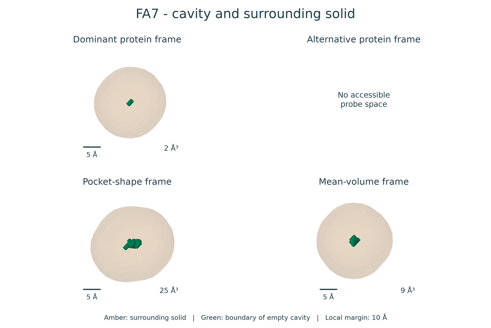
</picture>

| Frame selection | Atomic lining residues | Cavity with surrounding solid | All pocket models |
|---|---|---|---|
| Dominant protein frame | [PDB](../structures/representative/whole_protein/FA7/residues.pdb) | [OBJ](../structures/representative/whole_protein/FA7/pocket_solid.obj), [PDB](../structures/representative/whole_protein/FA7/pocket_solid.pdb), [SDF](../structures/representative/whole_protein/FA7/pocket_solid.sdf) | [Folder](../structures/representative/whole_protein/FA7) |
| Alternative protein frame | [PDB](../structures/representative/whole_protein_group_2/FA7/residues.pdb) | [OBJ](../structures/representative/whole_protein_group_2/FA7/pocket_solid.obj), [PDB](../structures/representative/whole_protein_group_2/FA7/pocket_solid.pdb), [SDF](../structures/representative/whole_protein_group_2/FA7/pocket_solid.sdf) | [Folder](../structures/representative/whole_protein_group_2/FA7) |
| Pocket-shape frame | [PDB](../structures/representative/pocket_geometry/FA7/residues.pdb) | [OBJ](../structures/representative/pocket_geometry/FA7/pocket_solid.obj), [PDB](../structures/representative/pocket_geometry/FA7/pocket_solid.pdb), [SDF](../structures/representative/pocket_geometry/FA7/pocket_solid.sdf) | [Folder](../structures/representative/pocket_geometry/FA7) |
| Mean-volume frame | [PDB](../structures/representative/mean_volume/FA7/residues.pdb) | [OBJ](../structures/representative/mean_volume/FA7/pocket_solid.obj), [PDB](../structures/representative/mean_volume/FA7/pocket_solid.pdb), [SDF](../structures/representative/mean_volume/FA7/pocket_solid.sdf) | [Folder](../structures/representative/mean_volume/FA7) |

